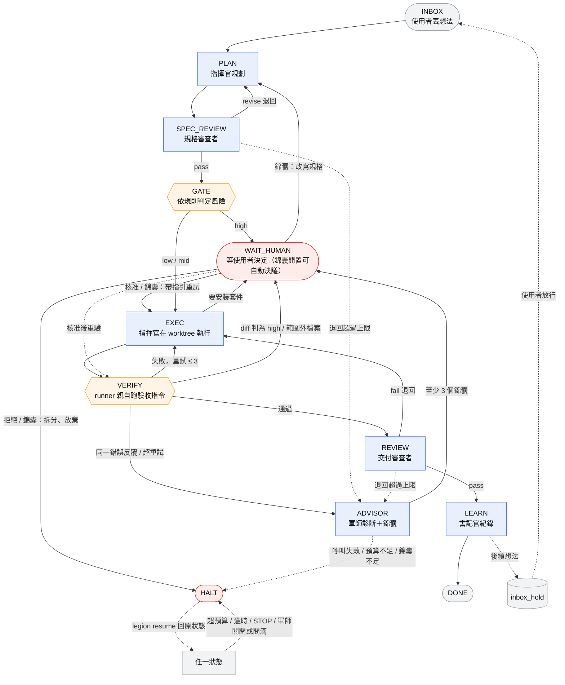
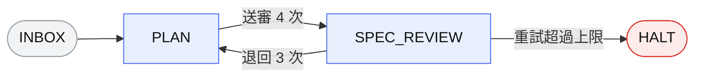
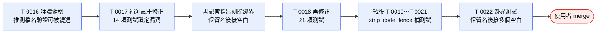

# agent-legion — 人掌舵、AI 自主執行的開發閉環

> 作者：**DavidY-tw**　│　© 2026 保留所有權利（見 [LICENSE](LICENSE)）　│　AI 協作：Claude

把一句想法丟進 Obsidian 的 `vault/INBOX/`，agent-legion 就會讓 Claude 分工完成**規劃 → 規格審查 → 風險判定 → 執行 → 驗證 → 交付審查 → 紀錄**，需要人決定的事才停下來問。

設計原則：**判斷交給 LLM（怎麼拆、怎麼做），邊界交給程式（能不能做、花多少、何時停）。** agent 的自述一律不採信，驗收指令由 runner 親自執行，證據以 SHA-256 鎖定。

## 閉環流程

<!-- legion:flow:start -->
<p align="center"></p>

圖例：藍色＝Claude 擔任的角色、橘色＝runner 以程式判斷（不經 LLM）、紅色＝停下來等人或熔斷、灰色＝起點、終點與暫存；虛線（畫布上為灰線）是例外或補救路徑。橘色光暈與底部字幕依序重播任務 T-0022 的真實路徑，連線上的虛線往流向移動；系統開啟「減少動態」時不播放。

<details><summary>靜態版（mermaid 原始碼，GitHub 直接渲染）</summary>



</details>
<!-- legion:flow:end -->

| 角色 | 由誰擔任 | 權限 |
|---|---|---|
| 指揮官（規劃、執行） | Claude（`claude -p`，每次全新 session） | 規劃唯讀；執行只能改自己的 git worktree |
| 規格審查者、交付審查者 | Claude 全新 session | 唯讀 |
| 書記官 | Claude 全新 session | 只寫敘述，不能改證據 |
| 軍師（錦囊妙計） | Claude 全新 session，只在任務卡住時請示 | 唯讀；提出至少 3 個錦囊並標出推薦，不能自己動手 |
| 參謀 | Claude 全新 session，戰役中每個任務結案時 | 唯讀；決定戰役「完成」或「下一個任務」 |
| 風險閘、驗證、熔斷、帳本 | runner（Python 程式） | 程式規則，不經 LLM |

### 實際跑出來的路徑

每個任務的紀錄文件都會依實際發生的狀態轉移自動畫出流程圖。兩個真實任務的對照：

- **一次收斂**（T-0017，$0.25，0 次重試）：`INBOX → PLAN → SPEC_REVIEW → GATE → EXEC → VERIFY → REVIEW → LEARN → DONE`，每一關都一次通過。
- **不收斂而熔斷**（T-0007，$0.42）：規格審查一直退回，重試超過上限後由 runner 停下，不會無限燒錢：



迭代發生在任務之間：健檢找出問題，下一個任務用測試鎖定並修正，書記官再指出剩下的缺口。以下是對一個 Telegram bot 專案實跑的例子，每一步都由測試驗證，最後由使用者決定 merge（目前該專案共 53 項測試）：



戰役會遇到停下來的情況：第一場戰役（repo-b-tests）在 T-0020 碰到預算上限而停下，使用者換個寫法重開第二場（repo-b-tests-2），T-0021 一次完成。T-0022 則是規格和守門規則衝突：規格要求在單行參數清單尾端加案例，守門規則把這種改動判為削弱既有測試，執行重試 3 次仍失敗。runner 請示軍師，軍師診斷出「不是執行者能力問題，是規格與規則衝突」，提出 4 個錦囊：A 改規格把案例移到新的測試函式（推薦）、B 由人核准這一行例外、C 拆成兩個子任務、D 放棄這個案例。因為任務是 high 風險，不會自動決議；使用者選 B，人工驗證後手動合併，規劃提示也補上說明，避免再發生。

## 環境需求

| 項目 | 用途 | 備註 |
|---|---|---|
| Windows 10/11 + PowerShell 5.1 | 主要開發環境 | 程式本身跨平台，啟動腳本為 `.bat`／`.ps1` |
| Python 3.10 | runner | 以 `py -3.10` 建立 `.venv` |
| Docker Desktop | PostgreSQL 16 | 只綁 `127.0.0.1` |
| Claude Code CLI（`claude`） | 真實 agent | 需已登入；只跑 mock 時不需要 |
| Node.js | Mermaid 轉圖（`tools/mermaid`） | 選用；失敗時任務不會中斷。mmdc 位置可用 `LEGION_MERMAID_CLI` 覆寫（git worktree 驗證時指回主目錄） |
| Edge 或 Chrome | Mermaid 轉圖用的瀏覽器 | 自動偵測，或設 `LEGION_BROWSER` |
| LibreOffice | 紀錄文件轉 PDF | 選用；自動偵測，或設 `LEGION_SOFFICE` |
| Obsidian | 看 vault 儀表與紀錄 | 選用 |

## 快速開始

```bat
git clone <this repo>
cd agent-legion
scripts\start.bat
```

`start.bat` 會依序：啟動 DB（compose 專案名稱固定取主 repo 資料夾名稱，所以在 git worktree 裡執行也會沿用同一個 DB；可用 `COMPOSE_PROJECT_NAME` 覆寫） → 建立 `.venv` 並安裝套件（第一次）→ 建表（`legion init-db`）→ 建 vault 骨架（`legion init-vault`）→ 跑一次**零成本**的 mock demo（3 個任務＋1 個回灌，示範正常完成、高風險攔下、回灌）。完成後用 Obsidian 開啟 `vault/` 資料夾。

## 設定

所有路徑都是**相對於專案根目錄**，或由環境變數覆寫，程式裡沒有寫死個人環境的路徑。可設定的變數與預設值見 [.env.example](.env.example)。

PowerShell 中臨時覆寫的例子：

```powershell
$env:LEGION_DB_PORT = "55433"
$env:LEGION_BROWSER = "C:\Program Files\Google\Chrome\Application\chrome.exe"
```

主要變數：

| 變數 | 預設 | 說明 |
|---|---|---|
| `LEGION_DB_USER`、`LEGION_DB_PASSWORD`、`LEGION_DB_NAME`、`LEGION_DB_PORT` | `legion`／`legion_local_only`／`legion`／`55432` | 本機開發用 DB，docker-compose 也讀同一組 |
| `LEGION_SCHEMA` | `legion` | 正式資料的 schema；demo 用 `demo`，測試用隨機 schema |
| `LEGION_VAULT`、`LEGION_DATA_DIR`、`LEGION_OUTPUT_DIR`、`LEGION_WORKTREES` | `./vault`、`./02_data`、`./01_output`、`./.worktrees` | 目錄位置 |
| `LEGION_BACKEND` | `claude` | agent backend（`mock` 為零成本模擬） |
| `LEGION_MODEL` | 不設定 | 設定後**所有角色**統一用這個模型、不升級（等同 `tick --model`）；平常不設定，改用下方的角色表 |
| `LEGION_MODEL_<角色>`、`LEGION_EFFORT_<角色>` | 見「模型分配」 | 逐角色覆寫，角色為 `PLANNER`、`SPEC_REVIEWER`、`EXECUTOR`、`REVIEWER`、`SCRIBE`、`ADVISOR`、`STRATEGIST`（例如 `LEGION_MODEL_PLANNER`、`LEGION_EFFORT_PLANNER`）；effort 設 `none` 表示不指定 |
| `LEGION_ESCALATE_MODEL`、`LEGION_ESCALATE_EFFORT` | `opus`、`high` | 執行者重做時的升級模型；`LEGION_ESCALATE_MODEL=off` 關閉升級 |
| `LEGION_ADVISOR`、`LEGION_ADVISOR_IDLE_MINUTES` | `1`、`15` | 卡住時請示軍師（`0` 關閉）；人閒置幾分鐘後自動決議：優先採用推薦錦囊，限安全種類、非 high 風險、預算內，見下方「軍師」 |
| `LEGION_SOFFICE`、`LEGION_BROWSER` | 自動偵測 | 外部工具位置 |
| `LEGION_RENDER_MERMAID`、`LEGION_MERMAID_CLI` | `1`、`tools\mermaid` 內的 mmdc | 是否把 mermaid 轉成圖片，以及 mmdc 位置（git worktree 裡沒有 node_modules 時指回主目錄） |
| `LEGION_FONT_MONO`、`LEGION_FONT_CJK` | `%WINDIR%\Fonts` 的 consola.ttf、msjh.ttc | 終端輸出轉圖用的字型 |
| `LEGION_CRASH_AT` | 不設定 | 只給測試用：設成 `STATE:point` 時在該處直接結束行程，模擬中途被中斷 |

熔斷數值（單任務 $2、每日 $2、重試 3、逾時 900 秒、回灌每輪 2／深度 2）在 [src/legion/config.py](src/legion/config.py)，`tick` 也可用 `--task-budget`、`--daily-budget` 暫時覆寫。

### 模型分配

runner（總指揮）替每次 agent 呼叫依角色選模型與 effort，每個角色都是全新的 `claude -p` session：

| 角色 | 第 1 次 | 重做時（驗收或審查失敗後） | 理由 |
|---|---|---|---|
| 指揮官（規劃） | Opus / medium | 同左 | 拆解與規格品質決定後面所有步驟 |
| 規格審查者 | Opus / medium | 同左 | 不能比規劃者弱，才抓得到規格的問題 |
| 指揮官（執行） | Sonnet / 預設 | **Opus / high** | 先用便宜的跑，失敗才加碼 |
| 交付審查者 | Sonnet / high | 執行升級過則 **Opus / high** | 審查者不低於執行者 |
| 書記官 | Haiku | 同左 | 只寫紀錄 |
| 軍師 | Opus / high | 同左 | 只在任務卡住時請示（見下方） |
| 參謀 | Opus / medium | 同左 | 只在戰役中決定下一步 |

```bat
.venv\Scripts\python.exe -m legion models
```

可列出目前實際生效的分配（含環境變數覆寫）。在 Obsidian 開 `vault/AI/模型分配.canvas` 可看角色與模型的關係圖（含官方單價與升級路線），`AI/流程.canvas` 的每個角色節點也標註了所用模型；兩張畫布都依實際設定自動產生，每次 tick 會更新。依據是研究報告中 Anthropic 自測的成本與通過率（廠商數字，未經獨立驗證），建議用 `02_data/metrics.csv` 對照自己的任務再調整。各角色內部不再派生 Claude Code 子代理（工具清單不含 Agent），所以表上就是全部會用到的模型。

### 軍師：卡住時提出錦囊

任務因「同一錯誤反覆出現」或「重試超過上限」要停下時，runner 會先請示軍師（唯讀、全新 session、每次上限 $0.5、每任務最多 2 次）：

1. 軍師讀失敗紀錄、審查意見與花費，診斷原因並提出**至少 3 個錦囊**，標出推薦的一個。
2. 錦囊寫進 `vault/AI/questions/<任務編號>.md`，任務轉入 WAIT_HUMAN 等你決定：`legion choose <任務編號> <選項>`，或 `legion answer <任務編號> approve` 採用推薦。
3. **你閒置 15 分鐘沒決定**（`LEGION_ADVISOR_IDLE_MINUTES` 可調），指揮官＋軍師自動決議：優先採用推薦，但只限「回到規劃重寫規格／依指引重做／拆成小任務／放棄」這四種，且風險不是 high、預估花費在剩餘預算內；都不符合就繼續等你。自動決議不計入人工介入，但會在紀錄中標示。
4. 需要你處理的事（提高預算、核准安裝、修改既有測試等）只會列為「需要你處理」，指揮官不會代做。

軍師呼叫失敗、預算不足或錦囊不足 3 個時，任務照原本規則停下。關閉軍師：`LEGION_ADVISOR=0`。

### 戰役：給目標，讓它自己一個接一個做

一般任務做完就停，後續想法要你放行。**戰役**則是你給一個目標和上限，軍團自己接續推進：

```markdown
---
title: 把 bot 的檔名驗證補到可靠
kind: write
repo: ../my-bot
allowed_paths: [telegram_bot.py, tests/**]
mission:
  goal: safe_workspace_path 與 strip_code_fence 都有完整測試，已知漏洞全部修掉
  max_tasks: 5        # 最多幾個任務（硬上限 10）
  budget_usd: 2       # 整場戰役的花費上限
---
先為 safe_workspace_path 補測試並修正已知漏洞。
```

- 每個任務結案時，**參謀**（Opus，唯讀）對照目標決定「完成」或「下一個任務」，下一個任務自動開始。
- 下一個任務**從上一個任務的分支接著做**（`legion/<任務編號>`），成果一路疊加；你最後只要檢查並 merge 最後一個分支，legion 不會動主分支。
- 每個任務照樣走完整閉環與所有防線；任務卡住或需要你核准時，戰役就停在那裡等你。達到任務數或花費上限、或下一步涉及 legion 本身，也會停。
- 戰役總預算在每次呼叫 agent 前都會檢查，執行中的任務也不能超支。
- 進度看 `vault/AI/missions/<戰役名稱>.md`。
- 戰役停下後想繼續：處理完卡住的任務後，丟一個新的戰役想法檔，加上 `base_branch: legion/<最後完成的任務編號>` 就會從那個分支接著做。

持續推進到沒事可做為止：

```bat
.venv\Scripts\python.exe -m legion run
```

## 人掌舵的入口

日常只需要看這幾個地方（手機也能看），其餘由 Claude Code 自主完成：

| 入口 | 內容 | 產生方式 |
|---|---|---|
| 每日晨報 `vault/AI/reports/brief-<日期>.md` | 等你處理的任務、停下的任務、待 merge 分支、可清理的分支、戰役進度、花費 | `legion brief`（不花額度；可排程每天跑；同時更新 Obsidian `AI/儀表.md` 的 KPI 卡） |
| 收件匣互動頁 | `03_docs/inbox.md` 的「待掌舵」「已決定」「可自主做」與後續想法分流；可篩選、展開，選好決定後複製回覆貼回對話 | `legion inbox --out <資料夾>/inbox.json`，和 `03_docs/inbox_page.html` 一起發布成 claude.ai artifact（私人連結，改 inbox 後重產並重新發布，連結不變） |
| 文件庫互動頁 | vault 的待你決定、報告、開發紀錄、戰役、交接、教訓、流程圖；手機可分類、搜尋、閱讀（Obsidian 只在桌機用時的手機入口；圖片仍請在桌機看） | `legion vault-json --out <資料夾>/vault.json`（匯出前遮蔽疑似機密並列出警告），和 `03_docs/vault_page.html` 一起發布成 claude.ai artifact；vault 仍是正本 |

分工：**定目標與範圍、花真錢、刪除未合併的工作、碰機密或對外服務、改預設模型或風險規則**由人決定；實作、驗證、合併已驗證的分支、整理清單、寫證據由 Claude Code 做，完成後在晨報或回報中告知。

## 使用方式

指令一律在專案根目錄執行。下表的 `legion` 代表 `.venv\Scripts\python.exe -m legion`；部分 Windows 環境的應用程式控制原則會擋 `.venv\Scripts\legion.exe`，用 `python -m` 形式即可。

### 1. 丟一個任務

在 `vault/INBOX/` 新增一個 `.md`，一個檔案一個任務：

```markdown
---
title: 為 downloader 加上重試
kind: write            # write＝可改檔（只在 worktree 內）；readonly＝只產報告
repo: ../my-project    # 目標 repo 的本機路徑（相對或絕對）
subdir: src            # 選填：限縮在子目錄（同時成為預設的改動範圍）
allowed_paths:         # 選填：只能改這些路徑（相對 repo 根目錄），超出就停下等你核准
  - src/downloader.py
  - tests/**
# allow_test_changes: true   # 選填：允許改寫或刪除既有測試（預設只能新增）
---
下載失敗最多重試 3 次、間隔 2 秒，補 pytest 並全部通過。
```

完成條件最好能用 `pytest` 或 `git` 指令驗證，runner 會親自執行。唯讀任務的報告寫到 `vault/AI/reports/<任務編號>-report.md`，報告中的 `檔名:行號` 會被程式逐筆核對。

### 2. 讓它跑

| 動作 | 指令 |
|---|---|
| 推進一輪（每輪每個任務走一步） | `legion tick --backend claude`（模型依角色分配，見上方「模型分配」） |
| 持續推進到沒事可做 | `legion run --backend claude`（可加 `--task-budget`、`--daily-budget`、`--max-ticks`） |
| 看各角色用哪個模型 | `legion models` |
| 每日晨報（等你處理的事、停下的任務、待 merge 分支、戰役、花費；不花額度） | `legion brief`，寫到 `vault/AI/reports/brief-<日期>.md`，並更新 `vault/AI/img/dashboard.svg` |
| 收件匣互動頁的資料（`03_docs/inbox.md` 的表格轉 JSON；格式不一致會報錯；不花額度） | `legion inbox --out <資料夾>/inbox.json`，再和 `03_docs/inbox_page.html` 一起發布成 artifact |
| 手機文件庫的資料（vault 的報告、紀錄、待決事項轉 JSON；遮蔽疑似機密；不花額度） | `legion vault-json --out <資料夾>/vault.json`，再和 `03_docs/vault_page.html` 一起發布成 artifact |
| 評測基準（8 道固定題目驗證閉環控制邏輯，mock、不花額度；有不符預期就回傳 1） | `legion bench` |
| 同步 README 的流程圖與儀表說明，並重新產生動態 SVG（`03_docs/img/` 與 `vault/AI/img/`；流程圖需要瀏覽器與 mmdc，請在 PowerShell 執行；儀表需要 DB） | `legion docs`；`legion docs --check` 只檢查 README |
| 看狀態 | `legion status` |
| 看版本、作者與原始出處 | `legion --version` |
| 定時自動跑（每 10 分鐘） | `powershell -ExecutionPolicy Bypass -File scripts\register_schedule.ps1`（加 `-Unregister` 移除） |

AI 只在 `.worktrees/<任務編號>/` 的獨立副本裡改檔，**原 repo 不會被動到，也不會自動 merge**。

### 3. 它停下來等你時

| 狀態 | 意思 | 處理 |
|---|---|---|
| `WAIT_HUMAN` | 高風險動作（刪檔、改 `.claude/`、需人工核准的安裝、驗收指令不在白名單等） | 讀 `vault/AI/questions/<任務編號>.md`，再 `legion answer <任務編號> approve` 或 `reject` |
| `WAIT_HUMAN`（驗收後） | 驗收指令跑完後出現超出允許範圍的檔案（例如測試寫出的 log） | 同上；核准以**路徑**為單位，之後同一路徑內容變了也不用再核准，不消耗重試次數 |
| `WAIT_HUMAN`（軍師錦囊） | 任務卡住，軍師提出 3 個以上錦囊 | `legion choose <任務編號> <選項>`，或 `legion answer <任務編號> approve` 採用推薦 |
| `HALT` | 熔斷（超預算、超重試、逾時、STOP 檔） | 排除原因後 `legion resume <任務編號>`；不再續跑就 `legion cancel <任務編號> --reason "原因"`（清掉續跑點，之後 `legion cleanup` 才會把它當成已結束）。注意：對進行中的任務 cancel 會先停成「可續跑的 HALT」，要完全收尾需再 cancel 一次 |

緊急全部停止：建立 `vault/STOP` 檔（內容不限）。

### 4. 做完之後

| 需求 | 指令或位置 |
|---|---|
| 看改了什麼 | `.worktrees/<任務編號>` 的分支，確認後自行 merge |
| 清理已 merge 的分支與 worktree | `legion cleanup` 先列出，`legion cleanup --apply` 才刪。只刪「任務已結束、分支已併入目標 repo 的 HEAD、worktree 乾淨（只容許快取資料夾）」的；游離 HEAD、rebase／merge 進行中、未併入、有被忽略檔、可續跑的 HALT、被其他任務當 `base_branch`、不在 `.worktrees/` 下的一律保留。晨報會列出「可清理」 |
| 看開發紀錄文件（8 章，結論都引用證據編號） | `vault/AI/records/<任務編號>/record.md` |
| 核可紀錄文件 | `legion approve-doc <任務編號>` |
| 匯出 Word／PDF（存到 `01_output/`） | `legion export <任務編號> --format docx` 或 `--format pdf` |
| 週報 | `legion report` |
| 後續想法 | 預設暫存在 `vault/AI/inbox_hold/`；要做就把檔案移回 `vault/INBOX/`。`tick --auto-followups` 可改為自動領取 |

### 在 Obsidian 看（與 GitHub 同一份定義）

用 Obsidian 開啟 `vault/` 資料夾：

| 檔案 | 內容 |
|---|---|
| `AI/流程.md` | 跟上方「閉環流程」**同一張動態圖**（`AI/img/flow.svg`），下方附靜態 mermaid |
| `AI/流程.canvas` | 同一份流程，可拖曳，Claude 角色節點標註實際分配的模型 |
| `AI/儀表.md` | 動態 KPI 卡（`AI/img/dashboard.svg`，與上方 GitHub 那張同一種；含最近幾次 `legion bench` 的結果）＋嵌入下面的儀表表格 |
| `AI/儀表.base` | 任務總覽，三個檢視如下 |
| `AI/模型分配.canvas` | 角色與模型、官方單價、升級路線 |

<!-- legion:dashboard:start -->
<p align="center"></p>

上圖是 `legion docs` 執行當下的快照（卡片上有資料時間）；Obsidian 的 `AI/儀表.md` 每次 `legion brief` 都會更新。

| 檢視 | 篩選或分組 | 欄位 |
|---|---|---|
| 依狀態 | 依狀態分組 | 任務、標題、狀態、風險、成本、人工介入、審查結論 |
| 依風險 | 依風險分組 | 任務、標題、風險、狀態、成本 USD |
| 等待使用者 | 只列 WAIT_HUMAN、HALT | 任務、標題、狀態、等待原因、熔斷原因 |

狀態圖示：✅ 完成、⛔ 熔斷、✋ 等你、⏳ 進行中；風險：🔴 高、🟡 中、🟢 低。
<!-- legion:dashboard:end -->

流程圖、畫布與儀表都定義在 [src/legion/diagrams.py](src/legion/diagrams.py)，動畫在 [src/legion/motion.py](src/legion/motion.py)：改了之後在 PowerShell 執行 `legion docs`，同步本 README 並重新產生 `03_docs/img/` 與 `vault/AI/img/` 的動態 SVG；`legion init-vault`、每次 tick 會更新 `流程.md`、`流程.canvas`、`儀表.base`，`legion brief` 每天更新 KPI 卡。`legion docs --check` 與測試（含 SVG 的來源指紋）會擋下兩邊不一致。動畫只用 SVG 內的 CSS（GitHub 與 Obsidian 都不執行腳本），系統開啟「減少動態」時不播放。

### 5. 零成本驗證

```bat
.venv\Scripts\python.exe -m pytest -q
.venv\Scripts\python.exe -m legion demo --mock
.venv\Scripts\python.exe -m legion bench
```

pytest 需要 DB 已啟動（`start.bat` 或 `docker compose up -d db`）。

`legion bench` 是評測基準：8 道固定題目（一次就過、驗收失敗重試、規格退回、交付審查退回、刪檔判高風險、範圍外檔案、同一錯誤請示軍師、後續想法暫存），在獨立的 schema、vault、worktree 裡用 mock 跑，約 25 秒、不花額度。每題都有預期結局，任何一題不符就代表閉環的控制邏輯被改壞了（例如拿掉「刪檔判高風險」規則，`high-risk` 那題會失敗）。結果存到 `02_data/bench/`、追加到 `metrics.csv`，儀表 KPI 卡會畫出最近幾次的趨勢。

## 安全邊界（程式強制）

- **風險只升不降**：agent 只能提議風險，最終取「規則判定」與「提議」的較高者；執行後再依實際 diff 重新判定。
- **角色工具最小化**：唯讀角色只拿得到 `Read`、`Glob`、`Grep`；執行者的 Bash 有允許與拒絕清單（安裝、push、merge、`.env`、金鑰一律拒絕）。
- **runner 才是硬邊界**：Bash 規則不是安全邊界，所以驗收指令由 runner 以白名單親自執行、比對 worktree 以外的 git 狀態、證據設為唯讀並比對雜湊。
- **既有測試只能新增**：runner 以**行級** diff 檢查，以下都算削弱、驗收直接失敗：刪除或改名既有測試檔、改寫既有測試的任何一行（包括只在單行 `parametrize` 清單尾端追加元素；新案例請寫成新行或新的測試函式，規劃提示已說明）、在既有測試檔加 skip／xfail 標記、重新定義同名測試、無法逐行比對的變更。新增測試檔、在既有測試補新案例都允許。
- **改變測試收集方式要人核准**：修改 pytest／pyproject／setup.cfg／tox 設定、`.gitignore`／`.gitattributes`、會作用到既有測試的 `conftest.py`，或用 git 索引旗標隱藏變更，判為 high、停下等核准。核准是綁定整份 diff 的內容，之後內容再變就要重新核准。真的要改既有測試，由人在想法檔寫 `allow_test_changes: true`。
- **改動範圍允許清單**：想法檔可寫 `allowed_paths`（glob，`dir/**` 代表整個子目錄）；有 `subdir` 時預設只能改該子目錄。超出範圍判為 high、停下等核准。兩者都只能由人設定，agent 無法替自己放寬。
- **範圍證據由 runner 產生**：每次驗收都相對「任務起點 commit」列出全部變更（agent 已 commit 的與未追蹤的新檔都算），寫成證據給審查者看；規劃者不必再寫 `git status --short` 這類 commit 後就變空的範圍指令。
- **同一錯誤 3 次即停**：驗收失敗會正規化成特徵（失敗的測試名稱與 exit code，忽略耗時等數字），同一特徵出現 3 次就 HALT，不等重試上限。
- **每次呼叫 agent 前檢查 STOP**：不只在 tick 開頭，長流程中途建立 `vault/STOP` 也會在下一次呼叫前停下。
- **原生 Windows 沒有 sandbox**：Claude Code 內建 sandbox 不支援原生 Windows，worktree 只隔離檔案。要給更高自主權的任務，請放在 WSL2 或容器裡執行。
- **安裝分級**：只在執行階段，由 runner 分成自動／自動＋通知／必須問，全部寫入 `02_data/install_ledger.csv`。
- **花費帳本**：每次 agent 呼叫都寫入 `02_data/cost_ledger.csv`（含模型與 effort；不隨 DB 重建消失），每日預算以帳本與 DB 較大者判定。
- **不留本機逐字紀錄**：`claude -p` 加上 `--no-session-persistence`；提示全文只存在本機 `.legion_tmp/prompts/`（不進 git），vault 只留雜湊。

## 專案結構

```
src/legion/      runner.py（狀態機）、agents.py（Claude CLI／Mock、角色權限）、prompts.py、risk.py、
                 installs.py、ledger.py、db.py、vault.py、evidence.py、record.py、checks.py、export.py、
                 brief.py（晨報）、cleanup.py（清理已併入分支）、inbox.py（收件匣轉 JSON）、
                 diagrams.py（流程圖與儀表的單一來源）、motion.py（動態 SVG）、mobile.py（vault 轉手機文件庫 JSON）、bench.py（評測基準）、
                 demo.py、config.py、cli.py
tests/           pytest 驗收（需 DB）
scripts/         start.bat、compose_name.ps1、wait_db.ps1、register_schedule.ps1、verify_artifacts.py、smoke_claude.ps1
sandbox_repo/    給 agent 練習用的玩具專案
tools/mermaid/   Mermaid 轉圖工具（npm）
vault/           Obsidian vault 骨架；任務紀錄在執行時產生，不進版控
02_data/         驗收證據、metrics、花費帳本、安裝清冊、bench/（評測基準每次的結果）
03_docs/         spec.md（v0.4）、spec_v0.5.md、progress.md（進度與事故紀錄）、inbox.md（任務收件匣）、
                 inbox_page.html（收件匣互動頁）、vault_page.html（手機文件庫）、sharing_and_citation.md（分享與引用規範）、
                 public_release_license.md（公開版授權方案）
LICENSE、NOTICE、CITATION.cff   授權、作者與出處標示、引用格式
reports/         研究報告
```

## 已知限制

- 排程只測過「使用者登入時執行」模式；電腦關機或 Claude 未登入時不會動。
- 花費是 Claude CLI 回報的用戶端估算（`total_cost_usd`），不是帳單金額。
- 規格審查與交付審查目前都用 Claude；跨廠商審查者（Codex）尚未實作。
- 評測基準目前只有 mock 模式，量的是 runner 的控制邏輯；用真實 Claude 量模型與 prompt 品質要花錢，尚未實作。
- 任務進行中沒有「核准修改既有測試」的路徑：要改既有測試必須事先在想法檔寫 `allow_test_changes: true`；否則只能由人自行驗證後手動 merge（T-0022 即如此處理）。
- 用 sonnet 做規劃＋規格審查單輪較便宜，但目前只有少數樣本，規格品質不足時下游重試反而更貴（見 `02_data/cost_analysis_20261114.md`）；預設仍是 Opus。
- 開發過程中的事故與修正都記在 [03_docs/progress.md](03_docs/progress.md)。

## 著作權與授權

© 2026 DavidY-tw，保留所有權利（All rights reserved），詳見 [LICENSE](LICENSE)。

- 本專案目前**沒有開放授權**：取得檢視權限不代表可以重製、修改、散布或商業使用。
- 開發過程使用 AI（Claude）作為輔助工具；構想、架構與流程設計、需求與驗收標準、取捨判斷、驗證與整合都由作者主導，並投入個人時間與成本。AI 產出均經作者審閱、修改與整合。
- **引用與分享須標示作者與出處**：標題、作者「DavidY-tw」、原始連結 https://github.com/lederyide-dotcom/agent-legion、授權（參照 CC 的 TASL 原則），並保留 [NOTICE](NOTICE)。GitHub 頁面的「Cite this repository」來自 [CITATION.cff](CITATION.cff)。完整規範見 [03_docs/sharing_and_citation.md](03_docs/sharing_and_citation.md)。
- 作者與出處也內建在程式裡：`legion --version`、`src/legion/__init__.py`，以及程式產生的開發紀錄與晨報頁尾；clone 後執行同樣會標示。
- 第三方套件依各自的授權條款使用。
- 作者保留日後另行公開的權利。公開版已決定採用：**程式碼 PolyForm Noncommercial 1.0.0、文件 CC BY-NC-SA 4.0**（可學習、研究、非商業使用，須署名；商業使用另洽作者）。目前版本仍保留所有權利，公開時才切換；公開版本的授權只適用於該版本所含的內容。細節與公開前的待辦見 [03_docs/public_release_license.md](03_docs/public_release_license.md)。
