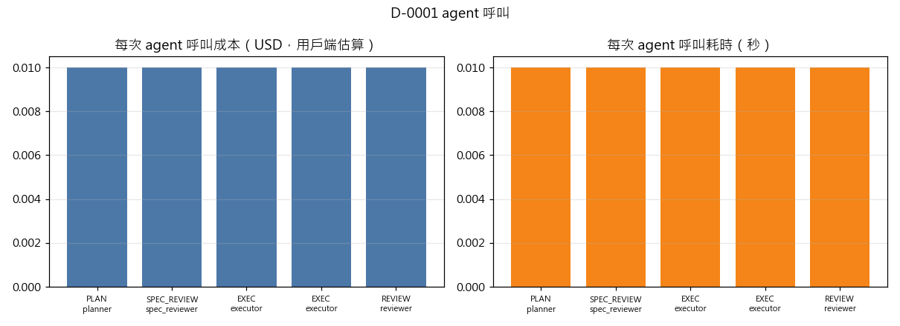
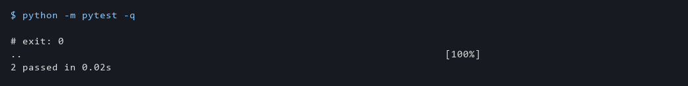

> [!warning] 草稿（AI 產生，未經核可）

# 開發紀錄：demo：為 calc 新增 multiply（D-0001）

## 1. 文件資訊

| 欄位 | 內容 |
|---|---|
| 編號 | D-0001 |
| 任務 | demo：為 calc 新增 multiply |
| 日期 | 2026-11-11 01:37:21 |
| 版本 | 0.4（step 10） |
| 狀態 | DONE |
| 文件狀態 | 草稿（AI 產生，未經核可） |
| 風險等級 | low |
| 成本（USD，用戶端估算） | 0.0600 |
| 人工介入次數 | 0 |
| 上層任務 | —（深度 0） |

## 2. 目標與範圍

以下引自規格 `specs/D-0001.md`：

> # demo：為 calc 新增 multiply
>
> ## 目標
> 低風險：在 worktree 內新增 multiply 並通過測試。
>
> ## 驗收
> - `python -m pytest -q`

## 3. 執行歷程

| # | 狀態 | 開始 | 結束 | 負責角色 | 模型 | agent 耗時（秒） |
|---|---|---|---|---|---|---|
| 1 | INBOX | 2026-11-11 01:37:21 | 2026-11-11 01:37:22 | Runner | — | — |
| 2 | PLAN | 2026-11-11 01:37:22 | 2026-11-11 01:37:22 | 指揮官（planner） | mock | 0.0 |
| 3 | SPEC_REVIEW | 2026-11-11 01:37:22 | 2026-11-11 01:37:22 | 規格審查者 | mock | 0.0 |
| 4 | GATE | 2026-11-11 01:37:22 | 2026-11-11 01:37:22 | Runner | — | — |
| 5 | EXEC | 2026-11-11 01:37:22 | 2026-11-11 01:37:22 | 指揮官（executor） | mock | 0.0 |
| 6 | VERIFY | 2026-11-11 01:37:22 | 2026-11-11 01:37:23 | Runner | — | — |
| 7 | EXEC | 2026-11-11 01:37:23 | 2026-11-11 01:37:23 | 指揮官（executor） | mock | 0.0 |
| 8 | VERIFY | 2026-11-11 01:37:23 | 2026-11-11 01:37:24 | Runner | — | — |
| 9 | REVIEW | 2026-11-11 01:37:24 | 2026-11-11 01:37:26 | 交付審查者 | mock | 0.0 |
| 10 | LEARN | 2026-11-11 01:37:26 | 2026-11-11 01:37:29 | 書記官 | mock | 0.0 |
| 11 | DONE | 2026-11-11 01:37:29 | — | — | — | — |

## 4. 設計與變更說明

### 4.1 流程圖（Mermaid）


*圖 1：本任務實際經過的狀態流程（Mermaid 轉圖）（E-014）*

Mermaid 原始碼：[E-013](evidence/E-013_flow_mermaid.mmd)

### 4.2 設計說明

本任務依規格在 worktree 內完成變更，驗證結果見（E-013、E-014）。

### 4.3 變更檔案與 diff 統計

```text
 calc.py | 4 ++++
 1 file changed, 4 insertions(+)
```
來源：[E-009](evidence/E-009_verify2_diffstat.txt)

### 4.4 成本與耗時


*圖 2：各次 agent 呼叫的成本與耗時（E-012）*

資料來源：[E-011](evidence/E-011_runs_csv.csv)

## 5. 驗證證據

### 5.1 驗收標準 1：`python -m pytest -q`

- 指令：`python -m pytest -q`
- 結果：exit 0，通過（E-006）
- 原始檔：[E-006](evidence/E-006_verify2_c1.txt)


*圖 3：驗收標準 1 的終端輸出（E-007）*

**結論**：runner 親自執行此指令，exit 0（E-006）。

### 5.2 Runner 附加檢查

- worktree 以外沒有檔案被修改（主 repo git 狀態相同）：通過（E-008）

### 5.3 先前的驗證嘗試

- 第 1 次：未通過，退回 EXEC（E-002）

## 6. 審查紀錄

### 6.1 規格審查

- 第 1 次結論：pass（E-001）
- 發現：無（E-001）
- 處置：放行（E-001）

**結論**：規格審查通過（E-001）。

### 6.2 交付審查

- 第 1 次結論：pass（E-010）
- 發現：無（E-010）
- 處置：放行（E-010）

**結論**：交付審查通過（E-010）。

## 7. 問題與教訓

mock 任務未遇到問題。

- 重試次數：1
- HALT 原因：無

## 8. 附錄：證據清冊

| 證據編號 | 檔名 | SHA-256 | 產生時間 | 產生者 |
|---|---|---|---|---|
| E-001 | evidence/E-001_spec_review.json | beaa28180a8bf466c35c57acc967e94126566e3395de2d7e73e3412afd170c5c | 2026-11-11 01:37:22 | runner（記錄 spec_review session mock-9e59ebac-1a1e-4abf-9c82-3917c7ce8fbd） |
| E-002 | evidence/E-002_verify1_c1.txt | 7251125487683dd306c6cc24c14156f81dd6942e7630d10f2b7500539380f78a | 2026-11-11 01:37:23 | runner |
| E-003 | assets/E-003_verify1_c1_term.png | b06abcf283979c53d89feabc73a88df3c3a445b2410f3bb9063f5c23ea7a6f64 | 2026-11-11 01:37:23 | runner |
| E-004 | evidence/E-004_verify1_outside.txt | 381d1c71556e18e1a6e06acdf82c5a1702ab66c45492ffa9d04a0bf71e98ce06 | 2026-11-11 01:37:23 | runner |
| E-005 | evidence/E-005_verify1_diffstat.txt | cad647f2c6b84a464f433c129a9e6b198a45ebf196d7ed79d46415f08e35a8cc | 2026-11-11 01:37:23 | runner |
| E-006 | evidence/E-006_verify2_c1.txt | ae4fb9d06ee21420ad5d00a3f7ecde37716f07d63f8fb335b7528d6e24386aa0 | 2026-11-11 01:37:24 | runner |
| E-007 | assets/E-007_verify2_c1_term.png | f348bf4614554a8f228038b2563ed3206aae5e3f036d27eda114247437741d52 | 2026-11-11 01:37:24 | runner |
| E-008 | evidence/E-008_verify2_outside.txt | 381d1c71556e18e1a6e06acdf82c5a1702ab66c45492ffa9d04a0bf71e98ce06 | 2026-11-11 01:37:24 | runner |
| E-009 | evidence/E-009_verify2_diffstat.txt | b59c28e0c81e39050712c83015235a0183d77ccb94f59d1250e5f084ec0eb38d | 2026-11-11 01:37:24 | runner |
| E-010 | evidence/E-010_review.json | beaa28180a8bf466c35c57acc967e94126566e3395de2d7e73e3412afd170c5c | 2026-11-11 01:37:26 | runner（記錄 review session mock-47855f6d-ad5c-42ed-a405-b9411739387b） |
| E-011 | evidence/E-011_runs_csv.csv | 5889efdbd2fc4d00bdd1021872d701ff2195c612018930f69da5ddbeb26beae0 | 2026-11-11 01:37:26 | runner |
| E-012 | assets/E-012_runs_chart.png | 5218a13586990656004c6527e8147eb57181b7e34bcd6aaf35fa95f326b6a984 | 2026-11-11 01:37:26 | runner |
| E-013 | evidence/E-013_flow_mermaid.mmd | 517cbdeaded39ad247b717f767b343a0cb6e9ab5766346bb9ed03447af570147 | 2026-11-11 01:37:26 | runner |
| E-014 | assets/E-014_flow_mermaid_png.png | e6868aeb09b6667cf63890b1526c750e6be9faf22a17ee778fcd52414211408c | 2026-11-11 01:37:28 | runner |
