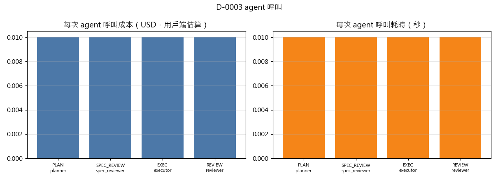
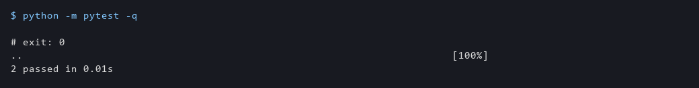

> [!warning] 草稿（AI 產生，未經核可）

# 開發紀錄：demo：為 calc 補 docstring（D-0003）

## 1. 文件資訊

| 欄位 | 內容 |
|---|---|
| 編號 | D-0003 |
| 任務 | demo：為 calc 補 docstring |
| 日期 | 2026-11-11 01:27:04 |
| 版本 | 0.4（step 8） |
| 狀態 | DONE |
| 文件狀態 | 草稿（AI 產生，未經核可） |
| 風險等級 | low |
| 成本（USD，用戶端估算） | 0.0500 |
| 人工介入次數 | 0 |
| 上層任務 | —（深度 0） |

## 2. 目標與範圍

以下引自規格 `specs/D-0003.md`：

> # demo：為 calc 補 docstring
>
> ## 目標
> 會回灌：結案時書記官提出 1 個後續想法寫回 INBOX。
>
> ## 驗收
> - `python -m pytest -q`

## 3. 執行歷程

| # | 狀態 | 開始 | 結束 | 負責角色 | 模型 | agent 耗時（秒） |
|---|---|---|---|---|---|---|
| 1 | INBOX | 2026-11-11 01:27:04 | 2026-11-11 01:27:04 | Runner | — | — |
| 2 | PLAN | 2026-11-11 01:27:04 | 2026-11-11 01:27:04 | 指揮官（planner） | mock | 0.0 |
| 3 | SPEC_REVIEW | 2026-11-11 01:27:04 | 2026-11-11 01:27:04 | 規格審查者 | mock | 0.0 |
| 4 | GATE | 2026-11-11 01:27:04 | 2026-11-11 01:27:04 | Runner | — | — |
| 5 | EXEC | 2026-11-11 01:27:04 | 2026-11-11 01:27:05 | 指揮官（executor） | mock | 0.0 |
| 6 | VERIFY | 2026-11-11 01:27:05 | 2026-11-11 01:27:06 | Runner | — | — |
| 7 | REVIEW | 2026-11-11 01:27:06 | 2026-11-11 01:27:06 | 交付審查者 | mock | 0.0 |
| 8 | LEARN | 2026-11-11 01:27:06 | 2026-11-11 01:27:11 | 書記官 | mock | 0.0 |
| 9 | DONE | 2026-11-11 01:27:11 | — | — | — | — |

## 4. 設計與變更說明

### 4.1 流程圖（Mermaid）


*圖 1：本任務實際經過的狀態流程（Mermaid 轉圖）（E-010）*

Mermaid 原始碼：[E-009](evidence/E-009_flow_mermaid.mmd)

### 4.2 設計說明

本任務依規格在 worktree 內完成變更，驗證結果見（E-001、E-002）。

### 4.3 變更檔案與 diff 統計

```text
 calc.py | 9 +++++++++
 1 file changed, 9 insertions(+)
```
來源：[E-005](evidence/E-005_verify1_diffstat.txt)

### 4.4 成本與耗時


*圖 2：各次 agent 呼叫的成本與耗時（E-008）*

資料來源：[E-007](evidence/E-007_runs_csv.csv)

## 5. 驗證證據

### 5.1 驗收標準 1：`python -m pytest -q`

- 指令：`python -m pytest -q`
- 結果：exit 0，通過（E-002）
- 原始檔：[E-002](evidence/E-002_verify1_c1.txt)


*圖 3：驗收標準 1 的終端輸出（E-003）*

**結論**：指令實際執行結果符合預期（E-001、E-002）。

### 5.2 Runner 附加檢查

- worktree 以外沒有檔案被修改（主 repo git 狀態相同）：通過（E-004）

## 6. 審查紀錄

### 6.1 規格審查

- 第 1 次結論：pass（E-001）
- 發現：無（E-001）
- 處置：放行（E-001）

**結論**：規格審查通過（E-001、E-002）。

### 6.2 交付審查

- 第 1 次結論：pass（E-006）
- 發現：無（E-006）
- 處置：放行（E-006）

**結論**：交付審查通過（E-001、E-002）。

## 7. 問題與教訓

mock 任務未遇到問題。

- 重試次數：0
- HALT 原因：無

## 8. 附錄：證據清冊

| 證據編號 | 檔名 | SHA-256 | 產生時間 | 產生者 |
|---|---|---|---|---|
| E-001 | evidence/E-001_spec_review.json | beaa28180a8bf466c35c57acc967e94126566e3395de2d7e73e3412afd170c5c | 2026-11-11 01:27:04 | runner（記錄 spec_review session mock-8505bdbd-a00f-4b81-8fa9-d462c68784b2） |
| E-002 | evidence/E-002_verify1_c1.txt | e843158e3988f454c6b565e4cb0ada59eab8d92f25b3505060acb70b57aa2d91 | 2026-11-11 01:27:06 | runner |
| E-003 | assets/E-003_verify1_c1_term.png | 8929bc39fa92ea460845b24770f285d367077e45dbd25050e1a363abc7ee5bf9 | 2026-11-11 01:27:06 | runner |
| E-004 | evidence/E-004_verify1_outside.txt | 79749abbbefed85090767434813a0e161f7bc71c4b1921ad84c5ea9080c826d3 | 2026-11-11 01:27:06 | runner |
| E-005 | evidence/E-005_verify1_diffstat.txt | e58f8e2b9d2ed62404ca01bfefb19bd5d1872676c511f4de9ca7e39a4ee1cbd2 | 2026-11-11 01:27:06 | runner |
| E-006 | evidence/E-006_review.json | beaa28180a8bf466c35c57acc967e94126566e3395de2d7e73e3412afd170c5c | 2026-11-11 01:27:06 | runner（記錄 review session mock-fc16e8f6-7522-42d5-86ee-a08ff2471f44） |
| E-007 | evidence/E-007_runs_csv.csv | cc10f32e1623b9ccd61c33132fbb4741c19959915e85104a6f491ea49d2f33b5 | 2026-11-11 01:27:07 | runner |
| E-008 | assets/E-008_runs_chart.png | b45772fb65755aab927f43e8dd4d7ac2ed91d005bc18ea9d6e7e363fabae8d1b | 2026-11-11 01:27:09 | runner |
| E-009 | evidence/E-009_flow_mermaid.mmd | 2a9fd9b5af9da1c0f238e5cf9c0320d353092b824a8712b8dcbe2cad3f054f18 | 2026-11-11 01:27:09 | runner |
| E-010 | assets/E-010_flow_mermaid_png.png | c1750ad90d9f416bb522ca27f189daa93b2d6e77f7a36a88aa3b3a3935779374 | 2026-11-11 01:27:11 | runner |
