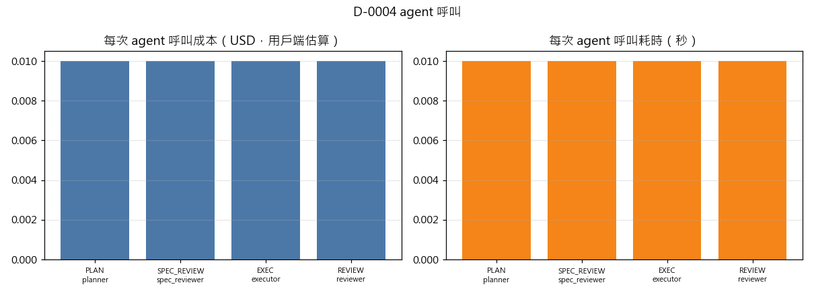
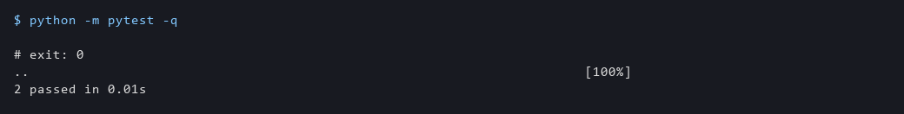

> [!warning] 草稿（AI 產生，未經核可）

# 開發紀錄：demo：新增 power 函式（D-0004）

## 1. 文件資訊

| 欄位 | 內容 |
|---|---|
| 編號 | D-0004 |
| 任務 | demo：新增 power 函式 |
| 日期 | 2026-11-11 07:52:59 |
| 版本 | 0.4（step 8） |
| 狀態 | DONE |
| 文件狀態 | 草稿（AI 產生，未經核可） |
| 風險等級 | low |
| 成本（USD，用戶端估算） | 0.0500 |
| 人工介入次數 | 0 |
| 上層任務 | D-0003（深度 1） |

## 2. 目標與範圍

以下引自規格 `specs/D-0004.md`：

> # demo：新增 power 函式
>
> ## 目標
> 書記官回灌的後續想法。
>
> ## 驗收
> - `python -m pytest -q`

## 3. 執行歷程

| # | 狀態 | 開始 | 結束 | 負責角色 | 模型 | agent 耗時（秒） |
|---|---|---|---|---|---|---|
| 1 | INBOX | 2026-11-11 07:52:59 | 2026-11-11 07:52:59 | Runner | — | — |
| 2 | PLAN | 2026-11-11 07:52:59 | 2026-11-11 07:53:00 | 指揮官（planner） | mock | 0.0 |
| 3 | SPEC_REVIEW | 2026-11-11 07:53:00 | 2026-11-11 07:53:00 | 規格審查者 | mock | 0.0 |
| 4 | GATE | 2026-11-11 07:53:00 | 2026-11-11 07:53:00 | Runner | — | — |
| 5 | EXEC | 2026-11-11 07:53:00 | 2026-11-11 07:53:01 | 指揮官（executor） | mock | 0.0 |
| 6 | VERIFY | 2026-11-11 07:53:01 | 2026-11-11 07:53:01 | Runner | — | — |
| 7 | REVIEW | 2026-11-11 07:53:01 | 2026-11-11 07:53:01 | 交付審查者 | mock | 0.0 |
| 8 | LEARN | 2026-11-11 07:53:01 | 2026-11-11 07:53:03 | 書記官 | mock | 0.0 |
| 9 | DONE | 2026-11-11 07:53:03 | — | — | — | — |

## 4. 設計與變更說明

### 4.1 流程圖（Mermaid）


*圖 1：本任務實際經過的狀態流程（Mermaid 轉圖）（E-010）*

Mermaid 原始碼：[E-009](evidence/E-009_flow_mermaid.mmd)

### 4.2 設計說明

本任務依規格在 worktree 內完成變更，驗證結果見（E-009、E-010）。

### 4.3 變更檔案與 diff 統計

```text
 calc.py | 14 ++++++++++++++
 1 file changed, 14 insertions(+)
```
來源：[E-005](evidence/E-005_verify1_diffstat.txt)

### 4.4 成本與耗時


*圖 2：各次 agent 呼叫的成本與耗時（E-008）*

資料來源：[E-007](evidence/E-007_runs_csv.csv)

## 5. 驗證證據

### 5.1 驗收標準 1：`python -m pytest -q`

- 指令：`python -m pytest -q`
- 結果：exit 0，通過（E-002）
- 原始檔：[E-002](evidence/E-002_verify1_c1.txt)


*圖 3：驗收標準 1 的終端輸出（E-003）*

**結論**：runner 親自執行此指令，exit 0（E-002）。

### 5.2 Runner 附加檢查

- worktree 以外沒有檔案被修改（主 repo git 狀態相同）：通過（E-004）

## 6. 審查紀錄

### 6.1 規格審查

- 第 1 次結論：pass（E-001）
- 發現：無（E-001）
- 處置：放行（E-001）

**結論**：規格審查通過（E-001）。

### 6.2 交付審查

- 第 1 次結論：pass（E-006）
- 發現：無（E-006）
- 處置：放行（E-006）

**結論**：交付審查通過（E-006）。

## 7. 問題與教訓

mock 任務未遇到問題。

- 重試次數：0
- HALT 原因：無

## 8. 附錄：證據清冊

| 證據編號 | 檔名 | SHA-256 | 產生時間 | 產生者 |
|---|---|---|---|---|
| E-001 | evidence/E-001_spec_review.json | beaa28180a8bf466c35c57acc967e94126566e3395de2d7e73e3412afd170c5c | 2026-11-11 07:53:00 | runner（記錄 spec_review session mock-d939f111-39b0-4b21-bd04-d12195d450aa） |
| E-002 | evidence/E-002_verify1_c1.txt | 6c10420ed71d70644f2ed0a90d024d46d69ee7f68b9551a9838e05d911377ece | 2026-11-11 07:53:01 | runner |
| E-003 | assets/E-003_verify1_c1_term.png | 8929bc39fa92ea460845b24770f285d367077e45dbd25050e1a363abc7ee5bf9 | 2026-11-11 07:53:01 | runner |
| E-004 | evidence/E-004_verify1_outside.txt | f17998ed053edaecad9835bca370d2a4df14367e4998497b930ce6e70874b176 | 2026-11-11 07:53:01 | runner |
| E-005 | evidence/E-005_verify1_diffstat.txt | b224af3325d6ce8ebd999f69413ecbf7c4f7754b23d472a81f8a680008624489 | 2026-11-11 07:53:01 | runner |
| E-006 | evidence/E-006_review.json | beaa28180a8bf466c35c57acc967e94126566e3395de2d7e73e3412afd170c5c | 2026-11-11 07:53:01 | runner（記錄 review session mock-0ebd6887-dfa5-4e2d-8a64-6967e95316a1） |
| E-007 | evidence/E-007_runs_csv.csv | d90dd260c1ce58cd5887458b52eaa623e6a9b6d17aea8e9a71d986f33ab2259c | 2026-11-11 07:53:01 | runner |
| E-008 | assets/E-008_runs_chart.png | b9b9317c21c27218cd46c2eed12d6fe751a7f11d707bb4d1c331787fa12faec7 | 2026-11-11 07:53:01 | runner |
| E-009 | evidence/E-009_flow_mermaid.mmd | 2a9fd9b5af9da1c0f238e5cf9c0320d353092b824a8712b8dcbe2cad3f054f18 | 2026-11-11 07:53:01 | runner |
| E-010 | assets/E-010_flow_mermaid_png.png | 3d59a2451b3426117a09fd7d034266832bc46e0060465b0ae17b8a184e64689e | 2026-11-11 07:53:03 | runner |
