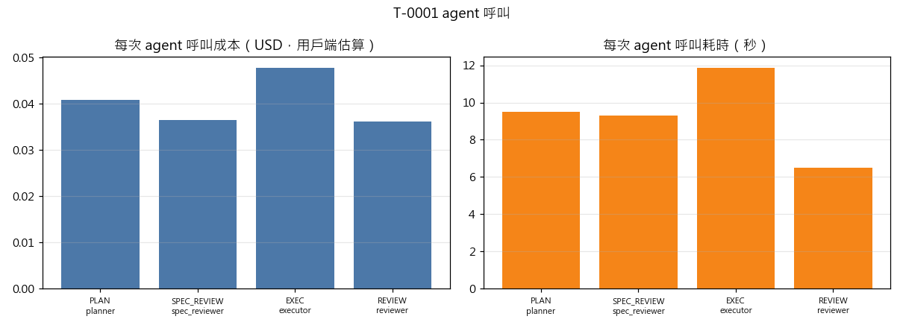
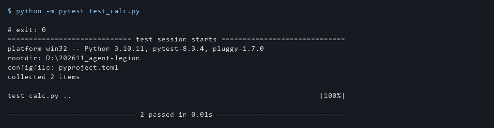
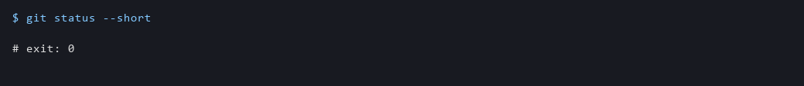

> [!warning] 草稿（AI 產生，未經核可）

# 開發紀錄：demo：為 calc 新增 multiply（T-0001）

## 1. 文件資訊

| 欄位 | 內容 |
|---|---|
| 編號 | T-0001 |
| 任務 | demo：為 calc 新增 multiply |
| 日期 | 2026-11-11 01:39:14 |
| 版本 | 0.4（step 8） |
| 狀態 | DONE |
| 文件狀態 | 草稿（AI 產生，未經核可） |
| 風險等級 | low |
| 成本（USD，用戶端估算） | 0.2205 |
| 人工介入次數 | 0 |
| 上層任務 | —（深度 0） |

## 2. 目標與範圍

以下引自規格 `specs/T-0001.md`：

> ## 目標
> 在 calc.py 新增 `multiply(a, b)`，回傳 a * b。
>
> ## 範圍
> - 僅修改 calc.py（新增函式）。
> - test_calc.py 已含 `test_multiply`（from calc import add, multiply），不需更動。
> - 不新增依賴、不刪檔、不碰網路。
>
> ## 驗收標準
> - `python -m pytest test_calc.py` exit 0（test_add、test_multiply 皆通過）。
> - 變更僅限 calc.py（git status 可確認）。

## 3. 執行歷程

| # | 狀態 | 開始 | 結束 | 負責角色 | 模型 | agent 耗時（秒） |
|---|---|---|---|---|---|---|
| 1 | INBOX | 2026-11-11 01:39:14 | 2026-11-11 01:39:14 | Runner | — | — |
| 2 | PLAN | 2026-11-11 01:39:14 | 2026-11-11 01:39:25 | 指揮官（planner） | sonnet | 9.5 |
| 3 | SPEC_REVIEW | 2026-11-11 01:39:25 | 2026-11-11 01:40:30 | 規格審查者 | sonnet | 9.3 |
| 4 | GATE | 2026-11-11 01:40:30 | 2026-11-11 01:41:23 | Runner | — | — |
| 5 | EXEC | 2026-11-11 01:41:23 | 2026-11-11 01:42:14 | 指揮官（executor） | sonnet | 11.9 |
| 6 | VERIFY | 2026-11-11 01:42:14 | 2026-11-11 01:43:52 | Runner | — | — |
| 7 | REVIEW | 2026-11-11 01:43:52 | 2026-11-11 01:44:15 | 交付審查者 | sonnet | 6.5 |
| 8 | LEARN | 2026-11-11 01:44:15 | 2026-11-11 01:45:43 | 書記官 | sonnet | 18.6 |
| 9 | DONE | 2026-11-11 01:45:43 | — | — | — | — |

## 4. 設計與變更說明

### 4.1 流程圖（Mermaid）


*圖 1：本任務實際經過的狀態流程（Mermaid 轉圖）（E-012）*

Mermaid 原始碼：[E-011](evidence/E-011_flow_mermaid.mmd)

### 4.2 設計說明

設計很單純：只在 calc.py 新增 `multiply(a, b)`，回傳 `a * b`，不動 test_calc.py，也不新增依賴（E-001、E-008）。規格審查確認 calc.py 原本只有 add，test_calc.py 已含 test_multiply，所以加入函式後測試即可通過（E-001）。實際 diff 為 calc.py 新增 4 行、共 1 個檔案變更（E-007）。流程經過 PLAN、SPEC_REVIEW、EXEC、REVIEW 四個 agent 步驟（E-009），狀態流程圖見 E-011、E-012。

### 4.3 變更檔案與 diff 統計

```text
 calc.py | 4 ++++
 1 file changed, 4 insertions(+)
```
來源：[E-007](evidence/E-007_verify1_diffstat.txt)

### 4.4 成本與耗時


*圖 2：各次 agent 呼叫的成本與耗時（E-010）*

資料來源：[E-009](evidence/E-009_runs_csv.csv)

## 5. 驗證證據

### 5.1 驗收標準 1：`python -m pytest test_calc.py`

- 指令：`python -m pytest test_calc.py`
- 結果：exit 0，通過（E-002）
- 原始檔：[E-002](evidence/E-002_verify1_c1.txt)


*圖 3：驗收標準 1 的終端輸出（E-003）*

**結論**：通過：指令 exit 為 0，收集 2 個測試且 2 passed（E-002）。審查也確認 test_add、test_multiply 皆通過（E-008）。終端截圖另存為 E-003，本敘述未依據圖檔下結論。

### 5.2 驗收標準 2：`git status --short`

- 指令：`git status --short`
- 結果：exit 0，通過（E-004）
- 原始檔：[E-004](evidence/E-004_verify1_c2.txt)


*圖 4：驗收標準 2 的終端輸出（E-005）*

**結論**：指令 exit 為 0，但輸出為空（E-004），所以這條指令本身無法直接證明「只有 calc.py 變更」。審查指出空輸出是因為變更已提交、工作樹乾淨（E-008）。範圍改以相對起點 commit 的 diff 統計確認：只有 calc.py 變更、4 行新增（E-007）。主 repo 在前後 HEAD 與狀態相同，worktree 以外沒有檔案被修改（E-006）。終端截圖為 E-005，未依據圖檔下結論。結論：範圍限制成立（E-007、E-006），但字面驗收指令的輸出與規格預期的 ` M calc.py` 不同（E-001、E-004）。

### 5.3 Runner 附加檢查

- worktree 以外沒有檔案被修改（主 repo git 狀態相同）：通過（E-006）

## 6. 審查紀錄

### 6.1 規格審查

- 第 1 次結論：pass（E-001）
- 發現：我實際讀了這兩個檔案，規格與現況一致。calc.py 目前只有 add。test_calc.py 已經有 test_multiply，內容是 multiply(4,5)==20，並從 calc 匯入 add 和 multiply。因此現在 pytest 會在匯入時失敗，加入 multiply 後就會通過。；範圍明確，只改 calc.py 並新增一個函式，實作 `return a * b` 就足夠。；兩條驗收指令都符合 runner 規則：`python -m pytest` 和 `git status --short`，沒有 shell 符號，也不需要安裝套件或連網。；小建議，不影響 pass：`git status --short` 只能確認有哪些檔案變更，不會自動判定通過或失敗。審查時要確認輸出只有 ` M calc.py`。也可以另外加 `git diff --stat` 讓範圍更清楚。；小建議，不影響 pass：目前只有一個測試案例 (4,5)。這個任務很簡單，足夠使用。（E-001）
- 處置：放行（E-001）

**結論**：規格審查 verdict 為 pass：審查者實際讀檔，確認規格與現況一致，範圍明確，兩條驗收指令符合 runner 規則（E-001）。審查提出兩個不影響 pass 的建議：git status --short 只列出變更檔案、不會自動判定通過或失敗，可加 git diff --stat；測試只有 (4,5) 一組案例，對此任務足夠（E-001）。

### 6.2 交付審查

- 第 1 次結論：pass（E-008）
- 發現：變更內容符合規格：calc.py 只新增 `multiply(a, b)`，回傳 `a * b`，沒有其他修改。；驗收標準 1：E-002 顯示 `python -m pytest test_calc.py` 的 exit 為 0，2 個測試（test_add、test_multiply）都通過。；驗收標準 2：E-007 顯示相對於起點 commit，只有 calc.py 變更（4 行新增）。E-004 的 `git status --short` 輸出是空的，這是因為變更已提交為 commit 1c76eef（工作樹乾淨），不是範圍問題。範圍要看 E-007 的 diff 統計才準確。；E-006 顯示主 repo 的 HEAD 與 status 在前後相同，worktree 以外沒有檔案被改動。；沒有新增依賴、沒有刪檔、沒有碰網路。（E-008）
- 處置：放行（E-008）

**結論**：實作審查 verdict 為 pass：calc.py 只新增 multiply(a, b) 並回傳 a * b（E-008）。驗收 1 由 E-002 支持，範圍由 E-007 支持，主 repo 未被改動由 E-006 支持，也沒有新增依賴、刪檔或碰網路（E-008）。審查指出 E-004 空輸出是因為變更已提交，範圍應看 E-007（E-008）。這個 commit 說明只出現在審查輸出中（E-008），我沒有獨立的 git log 證據。

## 7. 問題與教訓

主要問題：驗收標準 2 的 `git status --short` 在變更已提交後輸出為空（E-004），與規格審查預期的 ` M calc.py` 不符（E-001），要靠 diff 統計（E-007）才能證明範圍。教訓：範圍類驗收應直接寫成相對起點 commit 的 diff 指令，例如 git diff --stat，這也是規格審查已提出的建議（E-001）。另外 E-003、E-005 為圖檔，敘述端無法以文字驗證其內容。

- 重試次數：0
- HALT 原因：無

## 8. 附錄：證據清冊

| 證據編號 | 檔名 | SHA-256 | 產生時間 | 產生者 |
|---|---|---|---|---|
| E-001 | evidence/E-001_spec_review.json | 5c91b16af42f04ad0b7f2c9ef06d568d4753f98412769e94209335be94affa46 | 2026-11-11 01:40:30 | runner（記錄 spec_review session 5bfa6131-3acc-43ae-8013-19ca0d3acf2c） |
| E-002 | evidence/E-002_verify1_c1.txt | 96d4a2f036733f3c4ccac5427dd6bf7004c0fb5046427aad00aee9107f2e1631 | 2026-11-11 01:43:52 | runner |
| E-003 | assets/E-003_verify1_c1_term.png | 787dc57d606af38f8e5b8860d8bdb96f6783ebd9fc8918c7bcddfb692b39d342 | 2026-11-11 01:43:52 | runner |
| E-004 | evidence/E-004_verify1_c2.txt | 0ac1ff93b94c3b8f52ad8ab98164415cbf5b348f2d55c446bfcfddddb3a43b9d | 2026-11-11 01:43:52 | runner |
| E-005 | assets/E-005_verify1_c2_term.png | 3e51c452f63d45c459bda66ede1d252f773808a1e605cd04c5cd651e97838405 | 2026-11-11 01:43:52 | runner |
| E-006 | evidence/E-006_verify1_outside.txt | 381d1c71556e18e1a6e06acdf82c5a1702ab66c45492ffa9d04a0bf71e98ce06 | 2026-11-11 01:43:52 | runner |
| E-007 | evidence/E-007_verify1_diffstat.txt | b59c28e0c81e39050712c83015235a0183d77ccb94f59d1250e5f084ec0eb38d | 2026-11-11 01:43:52 | runner |
| E-008 | evidence/E-008_review.json | 4d351361c368bc4a5b34012270878cb32c2ba592b05e69b27dfabdd035da7ba9 | 2026-11-11 01:44:15 | runner（記錄 review session 844d6db1-5cea-4a72-87aa-89e520284c11） |
| E-009 | evidence/E-009_runs_csv.csv | d8ca85e56aa5eac1b68a2a3d685ddc86da34448d59fdbc953b80f00c274179b7 | 2026-11-11 01:45:22 | runner |
| E-010 | assets/E-010_runs_chart.png | 5bd2f97a52185ac355e3759a26311bc4c15aec71ef2ca9045655e0ed1ab480c9 | 2026-11-11 01:45:23 | runner |
| E-011 | evidence/E-011_flow_mermaid.mmd | 2a9fd9b5af9da1c0f238e5cf9c0320d353092b824a8712b8dcbe2cad3f054f18 | 2026-11-11 01:45:23 | runner |
| E-012 | assets/E-012_flow_mermaid_png.png | 510f1e48897c7bbb9ecdc7587dd583638d438076b5338794d812a996379f6095 | 2026-11-11 01:45:24 | runner |
