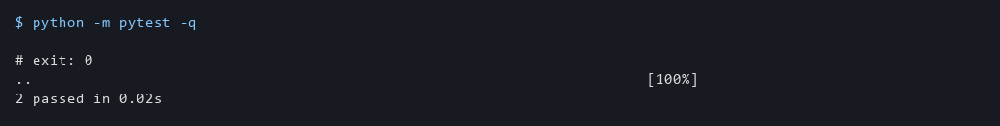
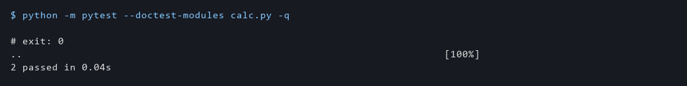
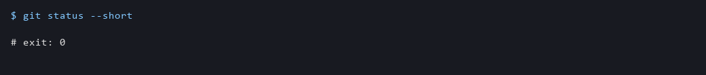

> [!warning] 草稿（AI 產生，未經核可）

# 開發紀錄：demo：為 calc 補 docstring（T-0003）

## 1. 文件資訊

| 欄位 | 內容 |
|---|---|
| 編號 | T-0003 |
| 任務 | demo：為 calc 補 docstring |
| 日期 | 2026-11-11 01:39:14 |
| 版本 | 0.4（step 9） |
| 狀態 | HALT |
| 文件狀態 | 草稿（AI 產生，未經核可） |
| 風險等級 | low |
| 成本（USD，用戶端估算） | 0.1305 |
| 人工介入次數 | 1 |
| 上層任務 | —（深度 0） |

## 2. 目標與範圍

以下引自規格 `specs/T-0003.md`：

> ## 目標
> 為 calc.py 的函式補上 docstring。
>
> ## 現況
> - calc.py 只有 `add(a, b)`,沒有 docstring。
> - test_calc.py 匯入了 `multiply`,但 calc.py 並未定義它,所以現在 pytest 在收集階段就會 ImportError。
>
> ## 範圍(僅限工作目錄內)
> - 修改 calc.py:
>   - 為 `add` 加上 docstring,含一行摘要、參數說明,以及 doctest 範例 `>>> add(2, 3)` → `5`。
>   - 新增 `multiply(a, b)` 並附相同格式的 docstring(含 doctest `>>> multiply(4, 5)` → `20`)。新增它只為了讓既有測試能匯入,不加其他功能。
> - 不改 test_calc.py,不改函式既有行為,不安裝套件,不 push 或 merge。
>
> ## 驗收標準
> 1. `python -m pytest -q` 全數通過(test_add、test_multiply)。
> 2. `python -m pytest --doctest-modules calc.py -q` 通過,證明 docstring 範例正確。
> 3. `git status --short` 能執行(exit 0);變更只有 calc.py。
>
> ## 備註
> `multiply` 超出單純補 docstring 的範圍,但缺了它測試無法通過。請審查者確認這個範圍擴充。

## 3. 執行歷程

| # | 狀態 | 開始 | 結束 | 負責角色 | 模型 | agent 耗時（秒） |
|---|---|---|---|---|---|---|
| 1 | INBOX | 2026-11-11 01:39:14 | 2026-11-11 01:39:14 | Runner | — | — |
| 2 | PLAN | 2026-11-11 01:39:14 | 2026-11-11 01:39:58 | 指揮官（planner） | sonnet | 20.6 |
| 3 | SPEC_REVIEW | 2026-11-11 01:39:58 | 2026-11-11 01:41:01 | 規格審查者 | sonnet | 11.9 |
| 4 | PLAN | 2026-11-11 01:41:01 | 2026-11-11 01:41:51 | 指揮官（planner） | sonnet | 13.8 |
| 5 | SPEC_REVIEW | 2026-11-11 01:41:51 | 2026-11-11 01:43:23 | 規格審查者 | sonnet | 11.0 |
| 6 | GATE | 2026-11-11 01:43:23 | 2026-11-11 01:44:07 | Runner | — | — |
| 7 | EXEC | 2026-11-11 01:44:07 | 2026-11-11 01:44:41 | 指揮官（executor） | sonnet | 12.3 |
| 8 | VERIFY | 2026-11-11 01:44:41 | 2026-11-11 01:45:59 | Runner | — | — |
| 9 | REVIEW | 2026-11-11 01:45:59 | 2026-11-11 07:41:20 | 交付審查者 | — | — |
| 10 | HALT | 2026-11-11 07:41:20 | — | Runner | — | — |

## 4. 設計與變更說明

### 4.1 流程圖（Mermaid）


### 4.3 變更檔案與 diff 統計

```text
 calc.py | 28 ++++++++++++++++++++++++++--
 1 file changed, 26 insertions(+), 2 deletions(-)
```
來源：[E-010](evidence/E-010_verify1_diffstat.txt)

## 5. 驗證證據

### 5.1 驗收標準 1：`python -m pytest -q`

- 指令：`python -m pytest -q`
- 結果：exit 0，通過（E-003）
- 原始檔：[E-003](evidence/E-003_verify1_c1.txt)


*圖 1：驗收標準 1 的終端輸出（E-004）*

### 5.2 驗收標準 2：`python -m pytest --doctest-modules calc.py -q`

- 指令：`python -m pytest --doctest-modules calc.py -q`
- 結果：exit 0，通過（E-005）
- 原始檔：[E-005](evidence/E-005_verify1_c2.txt)


*圖 2：驗收標準 2 的終端輸出（E-006）*

### 5.3 驗收標準 3：`git status --short`

- 指令：`git status --short`
- 結果：exit 0，通過（E-007）
- 原始檔：[E-007](evidence/E-007_verify1_c3.txt)


*圖 3：驗收標準 3 的終端輸出（E-008）*

### 5.4 Runner 附加檢查

- worktree 以外沒有檔案被修改（主 repo git 狀態相同）：通過（E-009）

## 6. 審查紀錄

### 6.1 規格審查

- 第 1 次結論：revise（E-001）
- 發現：現況描述屬實：calc.py 只有 add 且無 docstring；test_calc.py 匯入 multiply，目前 import 階段就會失敗。範圍與目標清楚，可執行。；主要缺口：驗收標準「add 與 multiply 都有非空 docstring」沒有任何指令能驗證。pytest 只檢查行為，不檢查 docstring。就算沒有 docstring，測試也會通過。建議二選一：(a) 在驗收指令加入 `python -m pydoc calc`，用輸出人工確認；(b) 放寬規則，讓驗收指令允許 `python -c`，或新增一個 docstring 檢查測試，但這會違反「只改 calc.py」。目前這項標準只能靠人工讀 diff，應在規格註明，或把驗收指令加入 `git diff`。；`git status --short` 只能證明變更的檔案是哪些，不能證明內容正確。建議加上 `git diff -- calc.py`，讓審查者看到實際的 docstring 與 multiply 實作。；「只改 calc.py」的檢查有漏洞：runner 是在 worktree（legion/D-xxxx 分支）內執行，`git status --short` 若未提交只顯示工作區變更。若執行者已經 commit，輸出會是空的，造成誤判。請明定驗收時的狀態是未提交，或改用 `git diff --stat main` 之類的指令，並確認 .gitignore 沒有忽略 __pycache__ 之外的東西。pytest 產生的 __pycache__ 與 .pytest_cache 若未被忽略，會出現在 git status，使「只出現 calc.py」失敗。請確認 .gitignore 涵蓋這兩者。；「清楚的 docstring」「說明參數與回傳值」沒有客觀格式要求（例如 Google 或 NumPy 風格、必須含 Args 與 Returns 段落）。建議明定風格，以免驗收主觀。；multiply 的備註要求「書記官在結案時註明」，但這不在驗收標準內，也無法由指令驗證。可以保留為流程備註，但別當成驗收項目。（E-001）
- 處置：退回 PLAN（E-001）

- 第 2 次結論：pass（E-002）
- 發現：規格與現況相符：calc.py 只有 add 且無 docstring；test_calc.py 確實匯入 multiply，現在收集階段會 ImportError。；範圍擴充（新增 multiply）合理且必要：test_multiply 斷言 multiply(4,5)==20，規格要求的實作與之一致。已確認此擴充。；驗收指令皆符合 runner 規則（python -m pytest、git status），不含 shell 符號。；指令 1 驗證既有測試，指令 2 驗證 docstring 的 doctest 範例，合起來足以涵蓋目標。；小建議（不影響通過）：指令 3 的 `git status --short` 只輸出狀態，exit 0 不能證明「變更只有 calc.py」，需由人或 runner 檢視輸出；可改為 `git diff --stat` 或 `git diff --name-only` 更直接。另外 pytest 可能產生 __pycache__/.pytest_cache，若 .gitignore 未排除，status 會出現未追蹤檔案，需留意。；小建議：可明說 docstring 以 Args 區段或其他固定格式撰寫，並要求 doctest 以 `>>>` 後接預期輸出行（5、20），避免實作者格式不一。（E-002）
- 處置：放行（E-002）

### 6.2 交付審查

（尚未進行）

## 7. 問題與教訓

- 重試次數：1
- HALT 原因：operator_cancel: demo 想法檔被正式 tick 誤領取，停止以免繼續花費

## 8. 附錄：證據清冊

| 證據編號 | 檔名 | SHA-256 | 產生時間 | 產生者 |
|---|---|---|---|---|
| E-001 | evidence/E-001_spec_review.json | a51964485484380c7180a97c6071217c791db0b0340f5737db061525699fa685 | 2026-11-11 01:41:01 | runner（記錄 spec_review session e0e483ea-9eea-41e0-b5eb-69b0e94a6f83） |
| E-002 | evidence/E-002_spec_review.json | 8f406adfd08b89275ebd605c7fa1a4585fb1802ad4e25f28f47f71203b1256b7 | 2026-11-11 01:43:23 | runner（記錄 spec_review session 4468a5b6-9f38-49c3-bfb2-a042cb96cc01） |
| E-003 | evidence/E-003_verify1_c1.txt | 0b73cb5f771454da0c0648f6557b5ff3e03e2b39b5e9bf7d30fc0085024c0832 | 2026-11-11 01:45:59 | runner |
| E-004 | assets/E-004_verify1_c1_term.png | f348bf4614554a8f228038b2563ed3206aae5e3f036d27eda114247437741d52 | 2026-11-11 01:45:59 | runner |
| E-005 | evidence/E-005_verify1_c2.txt | ac01017f2e619501738d13904cc9b6ef72a5ebca4f325759dbc9f028f6ce2db6 | 2026-11-11 01:45:59 | runner |
| E-006 | assets/E-006_verify1_c2_term.png | e79478727e249a228442e73723ff517a1fe54c16c36c11daf4a83ecaa85a8fc5 | 2026-11-11 01:45:59 | runner |
| E-007 | evidence/E-007_verify1_c3.txt | e874bdc234f1aeaa21dc2daa68dfb7af26267c7fafead4464c58010fe14aa6e4 | 2026-11-11 01:45:59 | runner |
| E-008 | assets/E-008_verify1_c3_term.png | 3e51c452f63d45c459bda66ede1d252f773808a1e605cd04c5cd651e97838405 | 2026-11-11 01:45:59 | runner |
| E-009 | evidence/E-009_verify1_outside.txt | 381d1c71556e18e1a6e06acdf82c5a1702ab66c45492ffa9d04a0bf71e98ce06 | 2026-11-11 01:45:59 | runner |
| E-010 | evidence/E-010_verify1_diffstat.txt | 55ca5686feba5251224cbd5ed80342cd30a53690c3135cda30a434fd8c99236f | 2026-11-11 01:45:59 | runner |
