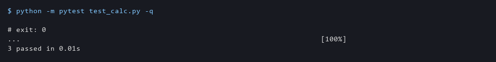
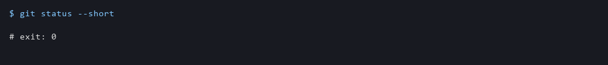

> [!warning] 草稿（AI 產生，未經核可）

# 開發紀錄：demo：新增 power 函式（T-0004）

## 1. 文件資訊

| 欄位 | 內容 |
|---|---|
| 編號 | T-0004 |
| 任務 | demo：新增 power 函式 |
| 日期 | 2026-11-11 01:39:14 |
| 版本 | 0.4（step 9） |
| 狀態 | HALT |
| 文件狀態 | 草稿（AI 產生，未經核可） |
| 風險等級 | low |
| 成本（USD，用戶端估算） | 0.1048 |
| 人工介入次數 | 1 |
| 上層任務 | D-0003（深度 1） |

## 2. 目標與範圍

以下引自規格 `specs/T-0004.md`：

> ## 目標
> 在 calc.py 新增 `power(base, exp)` 函式。
>
> ## 現況
> - calc.py 只有 `add`。
> - test_calc.py 已 import `multiply`，但 calc.py 沒有這個函式，所以目前收集測試時就會 ImportError。
>
> ## 範圍
> - calc.py：新增 `power(base, exp)`，回傳 `base ** exp`。
> - calc.py：補上 `multiply(a, b)`，回傳 `a * b`。這是讓既有測試能 import 的前置條件，不屬於新功能。
> - test_calc.py：保留既有測試，新增 `power` 的測試，並把 `power` 加進 import。
> - 不動其他檔案，不安裝任何東西。
>
> ## 驗收標準
> - `power(2, 3) == 8`
> - `power(5, 0) == 1`
> - `power(2, -1) == 0.5`
> - 既有的 `test_add`、`test_multiply` 也要通過。
> - `python -m pytest` 全數通過。

## 3. 執行歷程

| # | 狀態 | 開始 | 結束 | 負責角色 | 模型 | agent 耗時（秒） |
|---|---|---|---|---|---|---|
| 1 | INBOX | 2026-11-11 01:39:14 | 2026-11-11 01:39:14 | Runner | — | — |
| 2 | PLAN | 2026-11-11 01:39:14 | 2026-11-11 01:40:10 | 指揮官（planner） | sonnet | 12.1 |
| 3 | SPEC_REVIEW | 2026-11-11 01:40:10 | 2026-11-11 01:41:11 | 規格審查者 | sonnet | 9.7 |
| 4 | PLAN | 2026-11-11 01:41:11 | 2026-11-11 01:42:01 | 指揮官（planner） | sonnet | 10.0 |
| 5 | SPEC_REVIEW | 2026-11-11 01:42:01 | 2026-11-11 01:43:32 | 規格審查者 | sonnet | 9.3 |
| 6 | GATE | 2026-11-11 01:43:32 | 2026-11-11 01:44:07 | Runner | — | — |
| 7 | EXEC | 2026-11-11 01:44:07 | 2026-11-11 01:45:16 | 指揮官（executor） | sonnet | 33.6 |
| 8 | VERIFY | 2026-11-11 01:45:16 | 2026-11-11 01:46:00 | Runner | — | — |
| 9 | REVIEW | 2026-11-11 01:46:00 | 2026-11-11 07:41:21 | 交付審查者 | — | — |
| 10 | HALT | 2026-11-11 07:41:21 | — | Runner | — | — |

## 4. 設計與變更說明

### 4.1 流程圖（Mermaid）


### 4.3 變更檔案與 diff 統計

```text
 calc.py      | 12 ++++++++++--
 test_calc.py | 24 +++++++++++++++---------
 2 files changed, 25 insertions(+), 11 deletions(-)
```
來源：[E-008](evidence/E-008_verify1_diffstat.txt)

## 5. 驗證證據

### 5.1 驗收標準 1：`python -m pytest test_calc.py -q`

- 指令：`python -m pytest test_calc.py -q`
- 結果：exit 0，通過（E-003）
- 原始檔：[E-003](evidence/E-003_verify1_c1.txt)


*圖 1：驗收標準 1 的終端輸出（E-004）*

### 5.2 驗收標準 2：`git status --short`

- 指令：`git status --short`
- 結果：exit 0，通過（E-005）
- 原始檔：[E-005](evidence/E-005_verify1_c2.txt)


*圖 2：驗收標準 2 的終端輸出（E-006）*

### 5.3 Runner 附加檢查

- worktree 以外沒有檔案被修改（主 repo git 狀態相同）：通過（E-007）

## 6. 審查紀錄

### 6.1 規格審查

- 第 1 次結論：revise（E-001）
- 發現：規格的「現況」描述與實際檔案相符：calc.py 只有 add，test_calc.py 有 test_add、test_multiply 並 import multiply。補上 multiply 的範圍合理，也已說明理由。；必修（驗收缺口）：「git diff --stat」不足以驗證「git diff 只出現 calc.py 與 test_calc.py」。它只會列出已追蹤檔案的變更，不會顯示新建的未追蹤檔，例如 conftest.py 或 __pycache__ 以外的新檔。建議驗收指令加入「git status --short」，才能看到未追蹤的檔案。；必修：「git diff --stat」只輸出統計，不會自動判定通過或失敗，需要由審查者或 runner 比對檔名。建議在驗收標準寫明判定方式，例如「輸出只列出 calc.py 與 test_calc.py」。可改用「git diff --name-only」，輸出更容易比對。；建議：驗收標準應要求 test_power 實際涵蓋 power(2, 3) == 8，也就是正整數次方的具體案例。規格只寫「涵蓋正整數次方」，沒有指定數值。另外 pytest 只驗證測試通過，不保證 test_power 存在。建議加上「python -m pytest test_calc.py -k power」，或用 -v 確認 test_power 被收集並執行。；小問題：power(2, -1) == 0.5 依賴浮點數，這個值在二進位下可精確表示，所以沒有問題。負指數若換成其他底數，則應改用 pytest.approx。（E-001）
- 處置：退回 PLAN（E-001）

- 第 2 次結論：pass（E-002）
- 發現：規格與實際檔案相符：calc.py 只有 add；test_calc.py 已 import multiply 並含 test_add、test_multiply，所以目前確實會 ImportError。範圍清楚，也有說明補 multiply 的原因。；驗收指令符合 runner 規則（python -m pytest 與 git status --short，沒有 shell 符號）。pytest 能驗證三個 power 案例與既有測試；git status --short 能確認只動到 calc.py 和 test_calc.py。；小建議（不擋行）：「python -m pytest 全數通過」和指令 `python -m pytest test_calc.py -q` 範圍略有不同，目前 repo 只有一個測試檔，所以實質等價。建議在驗收標準註明 power 的測試要覆蓋 (2,3)、(5,0)、(2,-1) 三個案例，這樣 pytest 通過才真的代表驗收標準成立。；小建議：git status --short 只列出變動檔，不會自動判定對錯。審查時要確認輸出只有 calc.py 和 test_calc.py，沒有多出其他檔案，例如 __pycache__ 或 .pytest_cache（若未被 gitignore 會顯示為未追蹤檔）。（E-002）
- 處置：放行（E-002）

### 6.2 交付審查

（尚未進行）

## 7. 問題與教訓

- 重試次數：1
- HALT 原因：operator_cancel: demo 想法檔被正式 tick 誤領取，停止以免繼續花費

## 8. 附錄：證據清冊

| 證據編號 | 檔名 | SHA-256 | 產生時間 | 產生者 |
|---|---|---|---|---|
| E-001 | evidence/E-001_spec_review.json | 650c3d4e96ab9bf1693f47fa120b01379b3497e5379215e332318d2c998254a9 | 2026-11-11 01:41:11 | runner（記錄 spec_review session 59445d09-3799-4427-af8c-7dbef07b6f83） |
| E-002 | evidence/E-002_spec_review.json | 1108ea6fd4bb2415bd45ca32cd67a10f69dc5fe5440d88733c75e948ce589311 | 2026-11-11 01:43:32 | runner（記錄 spec_review session 9f0f9d55-d553-4344-84f8-2d6502058047） |
| E-003 | evidence/E-003_verify1_c1.txt | 2a969eb6ceaeb87cdf301c854a22cb085328df6fe3c5a34dfa9eb4b738eb5832 | 2026-11-11 01:46:00 | runner |
| E-004 | assets/E-004_verify1_c1_term.png | f8cc7b3ff58115a609182bfacf5ea24d3c637b82f7a2623e27fb7db33606c627 | 2026-11-11 01:46:00 | runner |
| E-005 | evidence/E-005_verify1_c2.txt | 0cfd3f31f5d201e0807bfd0797b0b9f6947dc1b2d2a3c1fb0ba6437fdf1671cd | 2026-11-11 01:46:00 | runner |
| E-006 | assets/E-006_verify1_c2_term.png | 3e51c452f63d45c459bda66ede1d252f773808a1e605cd04c5cd651e97838405 | 2026-11-11 01:46:00 | runner |
| E-007 | evidence/E-007_verify1_outside.txt | 381d1c71556e18e1a6e06acdf82c5a1702ab66c45492ffa9d04a0bf71e98ce06 | 2026-11-11 01:46:00 | runner |
| E-008 | evidence/E-008_verify1_diffstat.txt | 48ff0e6f162e6acf93fb30b7e494419ad07919b760d8c0d1fbe1455b38011d37 | 2026-11-11 01:46:00 | runner |
