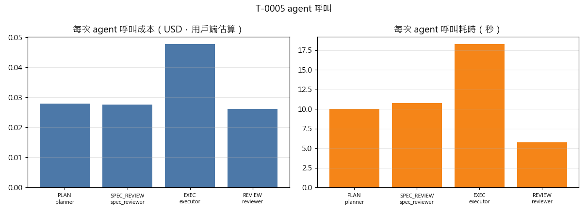
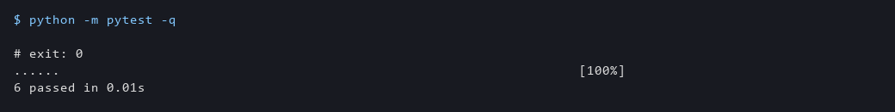
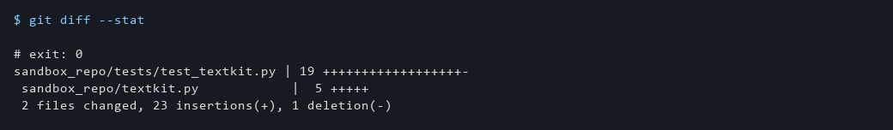

> [!warning] 草稿（AI 產生，未經核可）

# 開發紀錄：實戰 B：textkit 新增 word_count（T-0005）

## 1. 文件資訊

| 欄位 | 內容 |
|---|---|
| 編號 | T-0005 |
| 任務 | 實戰 B：textkit 新增 word_count |
| 日期 | 2026-11-11 01:39:14 |
| 版本 | 0.4（step 8） |
| 狀態 | DONE |
| 文件狀態 | 草稿（AI 產生，未經核可） |
| 風險等級 | low |
| 成本（USD，用戶端估算） | 0.1669 |
| 人工介入次數 | 0 |
| 上層任務 | —（深度 0） |

## 2. 目標與範圍

以下引自規格 `specs/T-0005.md`：

> ## 目標
> 在 textkit.py 新增 `word_count(text: str) -> int`。
>
> ## 範圍
> - 只改 sandbox_repo/textkit.py 與 sandbox_repo/tests/test_textkit.py。
> - 實作：`return len(text.split())`。str.split() 不帶參數會以任意連續空白切分並忽略頭尾空白，所以空字串與純空白都回傳 0。
> - 附 docstring，風格比照 slugify。
> - 測試要 import word_count，並涵蓋：一般句子、多重空白或換行或 tab、空字串、純空白。
> - 不新增依賴，不動其他檔案。
>
> ## 驗收標準
> - `python -m pytest -q` 全數通過（既有 slugify 測試仍通過）。
> - `word_count("a b  c")==3`、`word_count("")==0`、`word_count("   \n\t")==0`。
> - git diff 只出現這兩個檔案。

## 3. 執行歷程

| # | 狀態 | 開始 | 結束 | 負責角色 | 模型 | agent 耗時（秒） |
|---|---|---|---|---|---|---|
| 1 | INBOX | 2026-11-11 01:39:14 | 2026-11-11 01:39:14 | Runner | — | — |
| 2 | PLAN | 2026-11-11 01:39:14 | 2026-11-11 01:40:20 | 指揮官（planner） | sonnet | 10.0 |
| 3 | SPEC_REVIEW | 2026-11-11 01:40:20 | 2026-11-11 01:41:22 | 規格審查者 | sonnet | 10.7 |
| 4 | GATE | 2026-11-11 01:41:22 | 2026-11-11 01:42:01 | Runner | — | — |
| 5 | EXEC | 2026-11-11 01:42:01 | 2026-11-11 01:43:51 | 指揮官（executor） | sonnet | 18.3 |
| 6 | VERIFY | 2026-11-11 01:43:51 | 2026-11-11 01:44:07 | Runner | — | — |
| 7 | REVIEW | 2026-11-11 01:44:07 | 2026-11-11 01:45:22 | 交付審查者 | sonnet | 5.8 |
| 8 | LEARN | 2026-11-11 01:45:22 | 2026-11-11 01:46:16 | 書記官 | sonnet | 14.4 |
| 9 | DONE | 2026-11-11 01:46:16 | — | — | — | — |

## 4. 設計與變更說明

### 4.1 流程圖（Mermaid）


*圖 1：本任務實際經過的狀態流程（Mermaid 轉圖）（E-012）*

Mermaid 原始碼：[E-011](evidence/E-011_flow_mermaid.mmd)

### 4.2 設計說明

在 textkit.py 新增 word_count(text: str) -> int，實作為 len(text.split())，docstring 為單行中文，風格比照 slugify（E-008）。str.split() 不帶參數會以任意連續空白切分並忽略頭尾空白，因此空字串與純空白都回傳 0（E-001）。範圍限於 textkit.py 與 tests/test_textkit.py，未新增依賴（E-004、E-007）。

### 4.3 變更檔案與 diff 統計

```text
 sandbox_repo/tests/test_textkit.py | 19 ++++++++++++++++++-
 sandbox_repo/textkit.py            |  5 +++++
 2 files changed, 23 insertions(+), 1 deletion(-)
```
來源：[E-007](evidence/E-007_verify1_diffstat.txt)

### 4.4 成本與耗時


*圖 2：各次 agent 呼叫的成本與耗時（E-010）*

資料來源：[E-009](evidence/E-009_runs_csv.csv)

## 5. 驗證證據

### 5.1 驗收標準 1：`python -m pytest -q`

- 指令：`python -m pytest -q`
- 結果：exit 0，通過（E-002）
- 原始檔：[E-002](evidence/E-002_verify1_c1.txt)


*圖 3：驗收標準 1 的終端輸出（E-003）*

**結論**：通過。pytest 回報 6 passed、exit 0（E-002），終端輸出圖另附（E-003）。審查確認既有 slugify 的 2 個測試仍通過，且三個驗收斷言（"a b  c"==3、""==0、"   \n\t"==0）都在測試中（E-008）。

### 5.2 驗收標準 2：`git diff --stat`

- 指令：`git diff --stat`
- 結果：exit 0，通過（E-004）
- 原始檔：[E-004](evidence/E-004_verify1_c2.txt)


*圖 4：驗收標準 2 的終端輸出（E-005）*

**結論**：通過。diff 只出現 sandbox_repo/tests/test_textkit.py（19 行變動）與 sandbox_repo/textkit.py（5 行新增），共 2 個檔案、23 insertions、1 deletion，exit 0（E-004），終端輸出圖另附（E-005）。相對於起點 commit 的統計相同（E-007）。worktree 以外的 HEAD 與 status 前後相同（E-006）。限制：git diff --stat 只涵蓋已追蹤檔案，對未追蹤新檔沒有約束力（E-001、E-008）；此次兩個檔案都已追蹤，不影響結論。

### 5.3 Runner 附加檢查

- worktree 以外沒有檔案被修改（主 repo git 狀態相同）：通過（E-006）

## 6. 審查紀錄

### 6.1 規格審查

- 第 1 次結論：pass（E-001）
- 發現：可執行。sandbox_repo/textkit.py 與 tests/test_textkit.py 都已存在，slugify 的 docstring 是單行中文，可作為風格範本。`len(text.split())` 對空字串與純空白（包含 \n、\t）都回傳 0，和規格描述一致。；驗收指令都符合 runner 的白名單，沒有 shell 符號。；小缺口（不影響通過）：`git diff --stat` 只列出已追蹤檔案的修改，不會顯示新增的未追蹤檔案。這兩個檔案已被追蹤，所以可行。不過 repo 根目錄在上一層，vault/ 底下的未追蹤檔不會出現在 diff，「只出現這兩個檔案」也就只涵蓋已追蹤檔。；建議但非必要：驗收標準中的三個斷言（`word_count("a b  c")==3` 等）沒有獨立的驗收指令，只能靠測試檔涵蓋。要確保測試真的包含這三個案例，可在規格明列測試案例，或加上 `python -m pytest -q tests/test_textkit.py`。（E-001）
- 處置：放行（E-001）

**結論**：判定 pass。兩個目標檔案已存在，slugify 的單行中文 docstring 可作風格範本，len(text.split()) 對空字串與純空白都回傳 0，驗收指令符合白名單（E-001）。提出兩點：git diff --stat 不顯示未追蹤檔，以及三個斷言沒有獨立驗收指令，只能靠測試檔涵蓋（E-001）。兩點都不影響通過。

### 6.2 交付審查

- 第 1 次結論：pass（E-008）
- 發現：實作 `return len(text.split())` 與規格一致，docstring 為單行中文，風格比照 slugify。；測試已 import word_count，涵蓋一般句子、多重空白／換行／tab、空字串、純空白；三個驗收斷言（"a b  c"==3、""==0、"   \n\t"==0）都在測試中。；E-002：`python -m pytest -q` 6 passed、exit 0，既有 slugify 的 2 個測試仍通過。；E-004／E-007：diff 只出現 textkit.py 與 tests/test_textkit.py，沒有新增依賴。；E-006：worktree 以外的 HEAD 與 status 前後相同，唯一的未追蹤檔 vault/INBOX/real-b-word-count.md 是原本就有的。；小備註（不影響通過）：`git diff --stat` 只涵蓋已追蹤檔案，對未追蹤新檔沒有約束力。這次兩個檔案都已追蹤，所以不影響結論。（E-008）
- 處置：放行（E-008）

**結論**：判定 pass。實作與規格一致，docstring 風格比照 slugify，測試涵蓋一般句子、多重空白／換行／tab、空字串、純空白（E-008）。pytest 6 passed（E-002），diff 只含兩個指定檔案且無新增依賴（E-004、E-007），worktree 以外狀態未變（E-006）。小備註：git diff --stat 對未追蹤新檔沒有約束力，這次不影響結論（E-008）。

## 7. 問題與教訓

本次沒有出現失敗或重跑：兩項驗收各執行 1 次即通過（E-002、E-004）。唯一的觀察是 git diff --stat 只涵蓋已追蹤檔案，「只改這兩個檔案」的驗收對新增檔無約束力（E-001、E-008）。四次 agent 呼叫總成本約 0.13 美元（E-009：0.027968＋0.027596＋0.047787＋0.026136）。

- 重試次數：0
- HALT 原因：無

## 8. 附錄：證據清冊

| 證據編號 | 檔名 | SHA-256 | 產生時間 | 產生者 |
|---|---|---|---|---|
| E-001 | evidence/E-001_spec_review.json | 8018483703d2b38780e427b236202be618128cf736eba8f68f508b26850a34f7 | 2026-11-11 01:41:22 | runner（記錄 spec_review session 6a1a017f-842d-4086-bbf2-00f782d74076） |
| E-002 | evidence/E-002_verify1_c1.txt | c9986e68d9ec0d100887efd6460b5d97654b52114c1da8c1f3f04aae7f7b9100 | 2026-11-11 01:44:07 | runner |
| E-003 | assets/E-003_verify1_c1_term.png | e4fb92e4772a3e03ae7a98ccdf134e63a9c21b8fae174c598a03f5cc8ce671be | 2026-11-11 01:44:07 | runner |
| E-004 | evidence/E-004_verify1_c2.txt | e4895ddba914689d6acaf1c71383a3af8955f6f8ebe665e8d33112d2a9ba969e | 2026-11-11 01:44:07 | runner |
| E-005 | assets/E-005_verify1_c2_term.png | 050287497e3049e62ea9b47fe4a5cfbddbc12542645533ce23eea6ec3668d7a3 | 2026-11-11 01:44:07 | runner |
| E-006 | evidence/E-006_verify1_outside.txt | 7dab93f9f188fb953780b3add524db3ca84a90a55d681f3f4c25fad59ad9a162 | 2026-11-11 01:44:07 | runner |
| E-007 | evidence/E-007_verify1_diffstat.txt | d1e14680d31ce47aca840abccfc799a64cd419b8ff7f729ade344d0523ddcb4e | 2026-11-11 01:44:07 | runner |
| E-008 | evidence/E-008_review.json | 67a33ce7f488fc06bfe8f800463139dbc42b5d76a834e51d769a63e270dff83a | 2026-11-11 01:45:22 | runner（記錄 review session f7884339-fbc5-45e0-b2fe-18058969904c） |
| E-009 | evidence/E-009_runs_csv.csv | f38c02688eabd83c22aebffa393421185a463a234f24a25d38a3aa2c5e34882a | 2026-11-11 01:46:00 | runner |
| E-010 | assets/E-010_runs_chart.png | 5140d890520d88fd76d9771c8dc9846fd6873ad18500d83041ff4c2020afedce | 2026-11-11 01:46:00 | runner |
| E-011 | evidence/E-011_flow_mermaid.mmd | 2a9fd9b5af9da1c0f238e5cf9c0320d353092b824a8712b8dcbe2cad3f054f18 | 2026-11-11 01:46:00 | runner |
| E-012 | assets/E-012_flow_mermaid_png.png | dce64494018cb57dabc1a0138bad1a93d1bf0aade1af6813452df3156da03431 | 2026-11-11 01:46:02 | runner |
