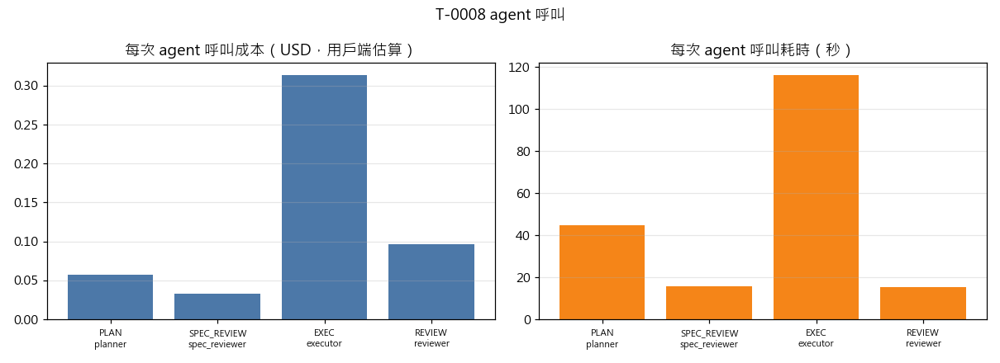
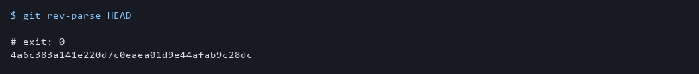
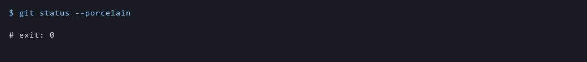
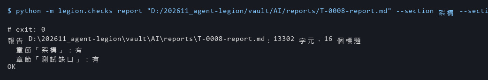

> [!warning] 草稿（AI 產生，未經核可）

# 開發紀錄：實戰 A（第三次）：PipeAI_wmt 架構與測試缺口健檢（T-0008）

## 1. 文件資訊

| 欄位 | 內容 |
|---|---|
| 編號 | T-0008 |
| 任務 | 實戰 A（第三次）：PipeAI_wmt 架構與測試缺口健檢 |
| 日期 | 2026-11-11 20:46:08 |
| 版本 | 0.4（step 8） |
| 狀態 | DONE |
| 文件狀態 | 草稿（AI 產生，未經核可） |
| 風險等級 | low |
| 成本（USD，用戶端估算） | 0.5708 |
| 人工介入次數 | 0 |
| 上層任務 | —（深度 0） |

## 2. 目標與範圍

以下引自規格 `specs/T-0008.md`：

> # T-0008 PipeAI_wmt 架構與測試缺口健檢（readonly）
>
> ## 目標
> 對 D:\PipeAI_wmt 做唯讀健檢，產出繁體中文報告（完整內容放在結構化輸出 `report_md`，執行者不寫任何檔案）。
>
> ## 範圍（只讀這些）
> - 根目錄腳本：`train_yolov8_local.py`、`all_in_one_processing_bbox_easyocr.py`、`all_in_one_processing_bbox_ocr_cloaud.py`、`inference_video.py`、`save_annotated_images.py`、`run_choice_no_docker.sh`、`Auto_run_no_docker.sh`
> - `data.yaml`、`03_docs/spec.md`、`CLAUDE.md`、`.gitignore`、`99_bk/` 內的舊版腳本
> - 測試相關：用 Glob 找 `test_*.py`、`*_test.py`、`conftest.py`、`pytest.ini`、`pyproject.toml`、`requirements*.txt`，限定在根目錄與 `tests/`
> - **禁止**遞迴掃描或讀取 `result/`、`annotated_images/`、`dataset/images`、`runs/`。`dataset/labels` 也不要用 `**` 全部列出，Glob 在根目錄用 `*.py` 會遞迴進 dataset。要列根目錄檔案時請用 `Get-ChildItem -File`，或直接指定檔名。
> - 不讀 `.env`、金鑰、憑證；不安裝任何東西；不執行腳本（避免載入模型或產生輸出檔）。
>
> ## 報告內容（章節標題須包含「架構」「測試缺口」，另加「其他風險」）
> 1. **架構**
>    - 各腳本職責表
>    - 資料流：影片／影像 → YOLO 偵測 → OCR（EasyOCR／PaddleOCR／pytesseract）→ CSV／標註圖
>    - 腳本之間的相依關係
>    - 重複程式碼（主流程 easyocr 版、cloud 版、舊版、`99_bk` 之間）：列出可抽出的共用函式
> 2. **測試缺口**
>    - 現有測試清單；若沒有，明說「無」
>    - 優先補測清單，依優先序排列，每項寫明理由與建議的測試方式：
>      - 字幕距離／管徑 OCR 解析
>      - CSV 輸出（`utf-8-sig`、檔名格式）
>      - bbox 座標換算
>      - 路徑處理
>      - data.yaml 與標註類別一致性檢查
>      - 無 GPU 時的 fallback
> 3. **其他風險**
>    - 寫死的 Linux／Windows 路徑
>    - 例外處理（裸 `except`、吞錯誤）
>    - 可維護性：魔術數字、全域狀態、無 CLI 參數、無 logging、`.sh` 啟動選單
>    - 與 CLAUDE.md 中 data.yaml 已知問題的關聯（只引用，不重做）
> 4. **建議行動順序**：給 3～5 項，並標示風險高低。
>
> ## 品質要求
> - 每個發現都附「檔案:行號」。
> - 區分「已讀到的事實」與「推測」。
>
> ## 驗收標準
> - 目標 repo 的 HEAD 與 `git status --porcelain` 在執行前後完全相同（沒有修改任何檔案）。
> - runner 附加的 report 檢查通過（報告存在、含「架構」「測試缺口」章節、長度足夠）。
> - 內容品質由人工審查者檢查。

## 3. 執行歷程

| # | 狀態 | 開始 | 結束 | 負責角色 | 模型 | agent 耗時（秒） |
|---|---|---|---|---|---|---|
| 1 | INBOX | 2026-11-11 20:46:08 | 2026-11-11 20:46:08 | Runner | — | — |
| 2 | PLAN | 2026-11-11 20:46:08 | 2026-11-11 20:46:53 | 指揮官（planner） | sonnet | 44.7 |
| 3 | SPEC_REVIEW | 2026-11-11 20:46:53 | 2026-11-11 20:47:10 | 規格審查者 | sonnet | 15.7 |
| 4 | GATE | 2026-11-11 20:47:10 | 2026-11-11 20:47:10 | Runner | — | — |
| 5 | EXEC | 2026-11-11 20:47:10 | 2026-11-11 20:49:07 | 指揮官（executor） | sonnet | 116.2 |
| 6 | VERIFY | 2026-11-11 20:49:07 | 2026-11-11 20:49:08 | Runner | — | — |
| 7 | REVIEW | 2026-11-11 20:49:08 | 2026-11-11 20:49:24 | 交付審查者 | sonnet | 15.3 |
| 8 | LEARN | 2026-11-11 20:49:24 | 2026-11-11 20:49:47 | 書記官 | sonnet | 20.2 |
| 9 | DONE | 2026-11-11 20:49:47 | — | — | — | — |

## 4. 設計與變更說明

### 4.1 流程圖（Mermaid）


*圖 1：本任務實際經過的狀態流程（Mermaid 轉圖）（E-014）*

Mermaid 原始碼：[E-013](evidence/E-013_flow_mermaid.mmd)

### 4.2 設計說明

本任務為唯讀健檢：執行者只用讀取類工具，完整報告放在結構化輸出，由 runner 寫入 vault 報告檔，不修改目標 repo（E-009）。規格審查結果為 pass，附 6 項建議（E-001），包含 .gitignore 排除輸出目錄導致 git status 看不到寫入、Glob 範圍限定、檔案可能不存在、runner 只檢查章節與長度。流程為 PLAN、SPEC_REVIEW、EXEC、REVIEW 四個 agent 步驟，皆用 sonnet（E-011）。報告共 13302 字元、16 個標題（E-006）。

### 4.3 變更檔案與 diff 統計

```text
唯讀任務：無檔案變更。
```
來源：[E-009](evidence/E-009_verify1_diffstat.txt)

### 4.4 成本與耗時


*圖 2：各次 agent 呼叫的成本與耗時（E-012）*

資料來源：[E-011](evidence/E-011_runs_csv.csv)

## 5. 驗證證據

### 5.1 驗收標準 1：`git rev-parse HEAD`

- 指令：`git rev-parse HEAD`
- 結果：exit 0，通過（E-002）
- 原始檔：[E-002](evidence/E-002_verify1_c1.txt)


*圖 3：驗收標準 1 的終端輸出（E-003）*

**結論**：執行後 HEAD 為 4a6c383a141e220d7c0eaea01d9e44afab9c28dc，exit 0（E-002）。前後比對結果為 SAME，before 與 after 的 HEAD 相同（E-008）。

### 5.2 驗收標準 2：`git status --porcelain`

- 指令：`git status --porcelain`
- 結果：exit 0，通過（E-004）
- 原始檔：[E-004](evidence/E-004_verify1_c2.txt)


*圖 4：驗收標準 2 的終端輸出（E-005）*

**結論**：輸出為空，exit 0（E-004）。前後狀態皆為 clean，比對結果為 SAME（E-008）。唯讀任務無檔案變更（E-009）。此結果只涵蓋未被 .gitignore 排除的路徑（E-001、E-010）。

### 5.3 驗收標準 3：`python -m legion.checks report "D:/202611_agent-legion/vault/AI/reports/T-0008-report.md" --section 架構 --section 測試缺口`

- 指令：`python -m legion.checks report "D:/202611_agent-legion/vault/AI/reports/T-0008-report.md" --section 架構 --section 測試缺口`
- 結果：exit 0，通過（E-006）
- 原始檔：[E-006](evidence/E-006_verify1_c3.txt)


*圖 5：驗收標準 3 的終端輸出（E-007）*

**結論**：檢查通過，exit 0。報告 13302 字元、16 個標題，「架構」與「測試缺口」章節皆存在，輸出 OK（E-006）。

### 5.4 Runner 附加檢查

- 目標 repo 未被修改（HEAD 與 git status 相同）：通過（E-008）

## 6. 審查紀錄

### 6.1 規格審查

- 第 1 次結論：pass（E-001）
- 發現：建議：驗收指令只比對 HEAD 與 `git status --porcelain`。`.gitignore` 排除了 result/、annotated_images/、dataset/、runs/、*.pt，所以寫入這些目錄的檔案不會在 status 中出現。「沒有修改任何檔案」只對被追蹤或未忽略的檔案成立。建議在規格註明這個限制，並補一條 `git status --porcelain --ignored`（白名單內）。不過 `--ignored` 可能掃描大目錄，建議評估後再決定。；建議:「Glob 在根目錄用 `*.py` 會遞迴進 dataset」與 Glob 的實際行為可能不符。請改成明確指示：Glob 一律帶 `path` 參數，限定在根目錄或 `tests/`，並且只用檔名模式，不加 `**`。；建議：測試相關的 Glob 搜尋（test_*.py、requirements*.txt 等）要明寫 path 只能是根目錄與 tests/。這樣不會誤入 dataset/、runs/、result/。；建議：`03_docs/spec.md`、`99_bk/`、`tests/` 不一定存在。請加一句「不存在時在報告中註明『不存在』，不算失敗」。；建議：runner 的 report 檢查只驗證章節標題與長度。「其他風險」章節、「檔案:行號」、「事實／推測」區分、「建議行動順序 3～5 項」都沒有機器檢查，只靠人工審查。可考慮加上 `--section 其他風險`，這需要 runner 支援，所以只是建議。；建議：「執行者不寫任何檔案」只是規則，沒有技術強制。可考慮在執行時限制工具為 Read／Grep／Glob，或唯讀的 shell。（E-001）
- 處置：放行（E-001）

**結論**：判定 pass，另有 6 項建議（E-001）：驗收指令無法偵測寫入被 .gitignore 排除的目錄；Glob 應明確帶 path 並避免 `**`；測試相關 Glob 應限定根目錄與 tests/；03_docs/spec.md、99_bk/、tests/ 可能不存在，應註明不算失敗；runner 未檢查「其他風險」、行號、事實／推測區分與行動項數；「執行者不寫檔案」沒有技術強制。

### 6.2 交付審查

- 第 1 次結論：pass（E-010）
- 發現：驗收標準 1：目標 repo 的 HEAD 前後都是 4a6c383，`git status --porcelain` 前後都是空的（E-002、E-004、E-008），沒有修改任何被追蹤的檔案。；驗收標準 2：runner 的 report 檢查通過（E-006）。報告共 13302 字元、16 個標題，含「架構」「測試缺口」章節。「其他風險」也存在（第 3 章），只是 runner 沒檢查它。；內容完整度：我讀了報告全文，規格要求的項目都有。有腳本職責表、資料流圖、相依關係、重複程式碼與 5 個可抽出的共用模組。測試缺口寫明現有測試為「無」，並列出 P1–P6 六項，各有理由與測試方式。其他風險涵蓋路徑、例外處理、可維護性，以及與 CLAUDE.md data.yaml 已知問題的對照。建議行動共 5 項，每項標了風險高低。；品質要求：報告用【事實】和【推測】標記區分，多數發現附檔案:行號。報告也承認只用 Grep 比對 `99_bk` 的關鍵行、沒有逐行 diff，並說明沒有掃描 `result/` 等目錄，也沒有執行任何腳本。；未驗證：我沒有逐條核對報告引用的行號。行號是否正確，需要人工抽查，例如 easyocr:105 的「方法 2」先於「方法 3」，以及 cloud 版管材正則是 `RC`、主流程是 `RCP`。這些主張具體且可檢驗。；限制（沿用 E-001 的建議，不影響 pass）：`.gitignore` 排除了 `result/`、`runs/` 等目錄，所以 `git status` 看不到寫入這些目錄的檔案。「沒有寫任何檔案」只對未被忽略的路徑有機器證據。報告檔本身寫在 vault（D:\202611_agent-legion），不在目標 repo 內，這與唯讀目標不衝突。（E-010）
- 處置：放行（E-010）

**結論**：判定 pass（E-010）。審查者認為兩項驗收標準通過（E-002、E-004、E-006、E-008），報告內容涵蓋規格要求：職責表、資料流、相依、重複程式碼、現有測試為「無」、P1–P6 補測清單、其他風險、5 項行動並標示風險。審查者未逐條核對行號，建議人工抽查，例如 easyocr:105 與管材正則 RC／RCP 的差異（E-010）。

## 7. 問題與教訓

本次三項驗收皆一次通過（E-002、E-004、E-006）。仍有未解決的限制：(1) git status 對被忽略目錄沒有證據力，「沒有寫任何檔案」只對未忽略路徑成立（E-001、E-010）。(2) 報告中的行號沒有被機器或審查者核對（E-010）。(3) runner 檢查沒有涵蓋「其他風險」章節（E-006、E-010）。(4) 只讀限制仍靠規則，沒有工具層強制（E-001）。

- 重試次數：0
- HALT 原因：無

## 8. 附錄：證據清冊

| 證據編號 | 檔名 | SHA-256 | 產生時間 | 產生者 |
|---|---|---|---|---|
| E-001 | evidence/E-001_spec_review.json | bd1e99d7a154fe9bf584016a7df377ec77fd89c5ab75dafb5344c7a94cf9b9f9 | 2026-11-11 20:47:10 | runner（記錄 spec_review session 65ee7c72-ce97-487f-a3f6-252377b1713b） |
| E-002 | evidence/E-002_verify1_c1.txt | dc6157ca4ff444996536497c455d19e413d25e3c96288e083553a45f878467f8 | 2026-11-11 20:49:07 | runner |
| E-003 | assets/E-003_verify1_c1_term.png | 4f560b46e70aba779eda95810e123a178b81d2798fd3f4b835940f52893a966f | 2026-11-11 20:49:07 | runner |
| E-004 | evidence/E-004_verify1_c2.txt | 1d90c57e3dd1d7f9c4f4d0e42f67e9f64413c1a7dcec919ea081e98c24305bca | 2026-11-11 20:49:07 | runner |
| E-005 | assets/E-005_verify1_c2_term.png | b1ae587dbecbec7fc850f05ce78ba8e7c22d6f1feaeef4a2a0785544a4db9d2f | 2026-11-11 20:49:07 | runner |
| E-006 | evidence/E-006_verify1_c3.txt | 5b15299767ddeaaaf6744a1e7aba0e29b0841d635f78b603d3d37a4d415c121f | 2026-11-11 20:49:08 | runner |
| E-007 | assets/E-007_verify1_c3_term.png | 9fbf356a0823fe817eedcc3071819081dd5d120889b1f13e5eb970a1ed98e407 | 2026-11-11 20:49:08 | runner |
| E-008 | evidence/E-008_verify1_outside.txt | 95a6e37f462a9216121c40ac2236e0b404ee5dc2bf2c8f958619e938dc6ca40d | 2026-11-11 20:49:08 | runner |
| E-009 | evidence/E-009_verify1_diffstat.txt | 3f89cd303e30076aab5471abd6c4c664af77bae992d98538f4a8e6c0144af8b3 | 2026-11-11 20:49:08 | runner |
| E-010 | evidence/E-010_review.json | 7a051f3cbc522a33a39cbf8cabfdeb1b122c828b5520ae10506469bcdfed0679 | 2026-11-11 20:49:24 | runner（記錄 review session 97ddac6d-4d81-4b2d-9d95-ee32f5e6d7a9） |
| E-011 | evidence/E-011_runs_csv.csv | de45f075fbbec67bb1909ca0a966b0a256677ff845929e5ff68ba670fa5a8da9 | 2026-11-11 20:49:24 | runner |
| E-012 | assets/E-012_runs_chart.png | 4095645dbacf04265e192deb78662feb0e3e13d98cb249e364a01e19eafb0a29 | 2026-11-11 20:49:25 | runner |
| E-013 | evidence/E-013_flow_mermaid.mmd | 2a9fd9b5af9da1c0f238e5cf9c0320d353092b824a8712b8dcbe2cad3f054f18 | 2026-11-11 20:49:25 | runner |
| E-014 | assets/E-014_flow_mermaid_png.png | 0aaa95f237cf0b0be7bb85514d9b2f22dd220145ac1a7a6c2cb13e8e7c4fa67a | 2026-11-11 20:49:26 | runner |
