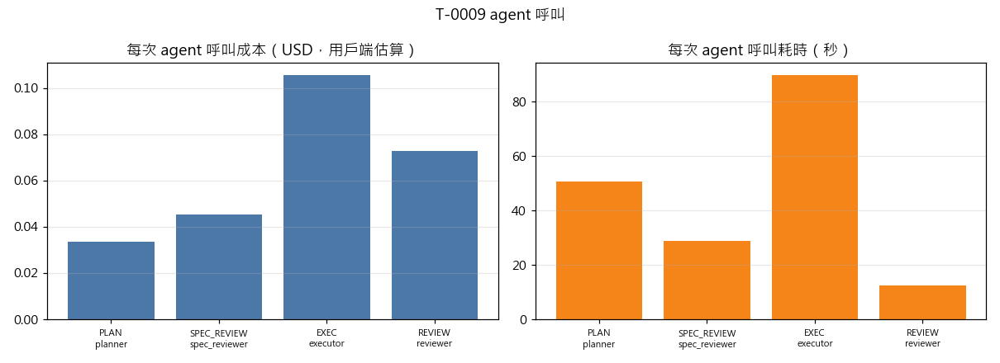
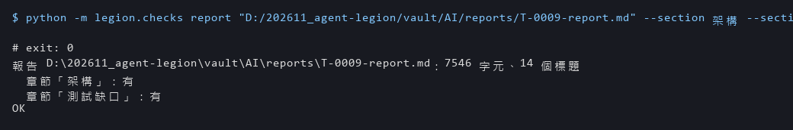

> [!warning] 草稿（AI 產生，未經核可）

# 開發紀錄：擴充 report 檢查（T-0009）

## 1. 文件資訊

| 欄位 | 內容 |
|---|---|
| 編號 | T-0009 |
| 任務 | 擴充 report 檢查 |
| 日期 | 2026-11-11 20:49:47 |
| 版本 | 0.4（step 8） |
| 狀態 | DONE |
| 文件狀態 | 草稿（AI 產生，未經核可） |
| 風險等級 | low |
| 成本（USD，用戶端估算） | 0.3060 |
| 人工介入次數 | 0 |
| 上層任務 | T-0008（深度 1） |

## 2. 目標與範圍

以下引自規格 `specs/T-0009.md`：

> ## T-0009 擴充 report 檢查（唯讀・設計調查報告）
>
> **現況發現**：工作目錄 D:\PipeAI_wmt 內沒有 `legion/` 套件（`legion/*.py` 搜尋無結果），D:\202611_agent-legion 下也找不到 `legion/*`。`legion.checks` 的原始碼不在本 repo，因此本任務不能直接實作，只產出「擴充設計報告」。實作另開 write 任務，目標 repo 為 agent-legion。
>
> ### 目標
> 說明如何讓 `python -m legion.checks report` 自動檢查三項目前只靠人工審查的內容（對應 E-006、E-010）：
> 1. 「其他風險」章節是否存在。
> 2. 每個發現是否附「檔案:行號」格式（如 `path/to/file.py:123`）。
> 3. 是否有【事實】／【推測】標記。
>
> ### 範圍
> - 執行者不寫任何檔案；完整報告放在 `report_md`。
> - 先確認 `legion.checks` 的實際位置（可能在別的 repo 或尚未建立），並如實回報。
> - 報告必須包含「架構」與「測試缺口」章節（runner 驗收要求），另加「其他風險」章節，並在每個發現標明【事實】或【推測】且附 檔案:行號。
> - 報告內容：
>   - 建議的 CLI 介面，例如新增 `--require-refs`、`--require-tags` 旗標，或預設啟用。
>   - 正規表示式草案：行號 `[\w./\\-]+\.\w+:\d+(-\d+)?`；標記 `【事實】|【推測】`。
>   - 誤判風險：Windows 路徑 `D:\...:12`、程式碼區塊內的內容、URL 的 `:port`。
>   - 逐項測試案例清單，以及向後相容策略，避免舊報告突然驗收失敗。
>
> ### 驗收標準
> - runner 自動附加的 report 檢查通過（章節齊全、長度足夠）。
> - 報告明確寫出 legion 原始碼是否找到。
> - 目標 repo 的 HEAD 與 `git status --porcelain` 執行前後不變。
> - 內容品質（行號、標記）由交付審查者人工審查。

## 3. 執行歷程

| # | 狀態 | 開始 | 結束 | 負責角色 | 模型 | agent 耗時（秒） |
|---|---|---|---|---|---|---|
| 1 | INBOX | 2026-11-11 20:49:47 | 2026-11-11 20:49:47 | Runner | — | — |
| 2 | PLAN | 2026-11-11 20:49:47 | 2026-11-11 20:50:38 | 指揮官（planner） | sonnet | 50.7 |
| 3 | SPEC_REVIEW | 2026-11-11 20:50:38 | 2026-11-11 20:51:47 | 規格審查者 | sonnet | 28.7 |
| 4 | GATE | 2026-11-11 20:51:47 | 2026-11-11 20:52:07 | Runner | — | — |
| 5 | EXEC | 2026-11-11 20:52:07 | 2026-11-11 20:53:37 | 指揮官（executor） | sonnet | 89.8 |
| 6 | VERIFY | 2026-11-11 20:53:37 | 2026-11-11 20:54:46 | Runner | — | — |
| 7 | REVIEW | 2026-11-11 20:54:46 | 2026-11-11 20:55:00 | 交付審查者 | sonnet | 12.4 |
| 8 | LEARN | 2026-11-11 20:55:00 | 2026-11-11 20:55:31 | 書記官 | sonnet | 16.2 |
| 9 | DONE | 2026-11-11 20:55:31 | — | — | — | — |

## 4. 設計與變更說明

### 4.1 流程圖（Mermaid）


*圖 1：本任務實際經過的狀態流程（Mermaid 轉圖）（E-012）*

Mermaid 原始碼：[E-011](evidence/E-011_flow_mermaid.mmd)

### 4.2 設計說明

T-0009 為唯讀設計調查任務。規格審查指出 legion 原始碼不在目前 repo，因此任務只產出「擴充 report 檢查」的設計報告，不直接實作（E-001）。報告在 §1.1 寫明 legion 原始碼未找到，並說明全碟搜尋逾時，所以不能斷言整台機器都沒有（E-008）。報告涵蓋 CLI 旗標（§1.4）、正規表示式草案（§1.5）、誤判風險 R1–R9、31 個測試案例（§3.2）與向後相容策略（§4）（E-008）。全程由 4 次 agent 呼叫完成：planner、spec_reviewer、executor、reviewer（E-009）。唯讀執行，無檔案變更（E-007）。

### 4.3 變更檔案與 diff 統計

```text
唯讀任務：無檔案變更。
```
來源：[E-007](evidence/E-007_verify1_diffstat.txt)

### 4.4 成本與耗時


*圖 2：各次 agent 呼叫的成本與耗時（E-010）*

資料來源：[E-009](evidence/E-009_runs_csv.csv)

## 5. 驗證證據

### 5.1 驗收標準 1：`git status --porcelain`

- 指令：`git status --porcelain`
- 結果：exit 0，通過（E-002）
- 原始檔：[E-002](evidence/E-002_verify1_c1.txt)


*圖 3：驗收標準 1 的終端輸出（E-003）*

**結論**：指令在 D:\PipeAI_wmt 執行，退出碼 0，輸出為空（E-002）。目標 repo 的 HEAD 前後皆為 4a6c383a141e220d7c0eaea01d9e44afab9c28dc，status 前後皆為 clean，結果 SAME（E-006）。唯讀任務無檔案變更（E-007）。通過。

### 5.2 驗收標準 2：`python -m legion.checks report "D:/202611_agent-legion/vault/AI/reports/T-0009-report.md" --section 架構 --section 測試缺口`

- 指令：`python -m legion.checks report "D:/202611_agent-legion/vault/AI/reports/T-0009-report.md" --section 架構 --section 測試缺口`
- 結果：exit 0，通過（E-004）
- 原始檔：[E-004](evidence/E-004_verify1_c2.txt)


*圖 4：驗收標準 2 的終端輸出（E-005）*

**結論**：退出碼 0，報告 7546 字元、14 個標題，「架構」與「測試缺口」章節皆有，輸出 OK（E-004）。通過。此外，runner 能執行 legion.checks，代表該模組在 runner 環境可用（E-004），但報告稱找不到原始碼（E-008），兩者並存，來源位置仍不明。

### 5.3 Runner 附加檢查

- 目標 repo 未被修改（HEAD 與 git status 相同）：通過（E-006）

## 6. 審查紀錄

### 6.1 規格審查

- 第 1 次結論：pass（E-001）
- 發現：建議：runner 自己要執行 `python -m legion.checks report ...`,代表該模組在 runner 環境一定存在(已安裝套件或其他路徑),與「找不到原始碼」看似矛盾。請要求執行者以唯讀方式查出實際位置(例如查看 D:\202611_agent-legion 的上層目錄與 site-packages);仍找不到時,報告要明確寫出「runner 能執行但原始碼位置不明」。；建議：規格沒說「目標 repo」在本任務是哪一個。內文先說工作目錄是 D:\PipeAI_wmt,又說實作目標是 agent-legion。請寫明 `git status --porcelain` 在哪個 cwd 執行,以及 HEAD 比對針對哪個 repo。；建議：legion 原始碼不存在,所以報告裡「每個發現附檔案:行號」只能引用其他檔案(例如既有報告或規格文件)。規格可以寫明可引用的範圍,並要求推測性內容標【推測】,以免硬湊行號。；建議：自動驗收只檢查「架構」和「測試缺口」兩個章節。「其他風險」章節、行號格式、標記都沒有指令驗證。規格已說明由人工審查,可以接受。審查者的檢查清單可以明列這三項:「其他風險」章節、行號格式、【事實】／【推測】標記。；建議：誤判風險清單可以再補幾項,例如 Windows 磁碟機代號 `D:` 後接數字的情形,以及 `file.py:12:34` 這種行號加欄號的寫法。向後相容策略也請標明是預設關閉旗標還是警告模式,並寫出遷移期限。（E-001）
- 處置：放行（E-001）

**結論**：結論為 pass，附 5 點建議（E-001）：查明 legion.checks 實際位置、釐清 git status 的 cwd 與目標 repo、無原始碼時只能引用其他檔案並標【推測】、人工審查清單明列三項、補充誤判情境與遷移期限。這些皆為建議，非必修（E-001）。

### 6.2 交付審查

- 第 1 次結論：pass（E-008）
- 發現：自動驗收都過了。E-004 顯示「架構」和「測試缺口」章節都有，報告 7546 字元。E-006 顯示 HEAD 前後都是 4a6c383，git status 前後都是 clean。E-007 為唯讀任務、無檔案變更。；報告明確寫出 legion 原始碼沒有找到（報告 §1.1）。我也用 Glob 在 D:\202611_agent-legion 下搜尋 legion/**/*.py，結果相同，沒有找到。報告同時說明全碟搜尋逾時，所以「整台機器都沒有」沒有被證實。這符合規格「如實回報」的要求。；三個人工審查項目都符合。第一，「其他風險」章節存在（§5）。第二，發現都附有檔案:行號，或註明「無行號可引」及搜尋路徑。我抽查了 T-0008-report.md 的 :6、:16、:18、:29、:50，內容與報告引述一致。第三，【事實】和【推測】標記一致，推論部分也都標了【推測】。；內容涵蓋規格要求的各項：CLI 旗標（§1.4）、regex 草案與其限制（§1.5，例如簡寫引用會漏抓）、誤判風險 R1–R9（含 Windows 路徑、程式碼區塊、URL 的 :port）、31 個測試案例（§3.2）、向後相容策略（§4）。E-001 的建議也大多吸收了：補了 `file.py:12:34` 以外的誤判情境、列了預設關閉與警告優先的分階段做法。；小缺點，不影響交付。第一，§1.1 只建議寫入任務去執行 `import legion.checks` 確認來源，沒有說明執行者自己為何沒做。第二，§4 沒有寫明遷移期限。第三，欄號寫法 `file.py:12:34` 沒有單獨成為案例。第四，R9 的 CLAUDE.md 引用沒有行號，報告已自行註明。（E-008）
- 處置：放行（E-008）

**結論**：結論為 pass（E-008）。自動驗收通過（E-004、E-006、E-007）。報告明確寫出 legion 原始碼未找到，審查者以 Glob 複查結果相同（E-008）。「其他風險」章節存在（§5），發現附檔案:行號或註明無行號可引，【事實】／【推測】標記一致（E-008）。小缺點四項：§1.1 未說明執行者為何沒自行 import 確認、§4 未寫遷移期限、欄號寫法未獨立成案例、R9 的 CLAUDE.md 引用無行號（E-008）。

## 7. 問題與教訓

1. runner 能執行 legion.checks（E-004），報告卻說找不到原始碼（E-008），矛盾尚未解決；規格審查已提出此點（E-001）。2. 報告的小缺點包含遷移期限缺漏與欄號案例缺漏（E-008）。3. 三項人工審查內容（其他風險章節、檔案:行號、事實／推測標記）沒有指令驗證，只能靠審查者（E-001、E-008）。

- 重試次數：0
- HALT 原因：無

## 8. 附錄：證據清冊

| 證據編號 | 檔名 | SHA-256 | 產生時間 | 產生者 |
|---|---|---|---|---|
| E-001 | evidence/E-001_spec_review.json | 186232537f6838ec5a7df6567df3cb4a0f1ceffaf418653ff43d16c450bd2f74 | 2026-11-11 20:51:47 | runner（記錄 spec_review session ef44a6c6-0c14-4b3c-a01a-43057e6cb608） |
| E-002 | evidence/E-002_verify1_c1.txt | 1d90c57e3dd1d7f9c4f4d0e42f67e9f64413c1a7dcec919ea081e98c24305bca | 2026-11-11 20:54:46 | runner |
| E-003 | assets/E-003_verify1_c1_term.png | b1ae587dbecbec7fc850f05ce78ba8e7c22d6f1feaeef4a2a0785544a4db9d2f | 2026-11-11 20:54:46 | runner |
| E-004 | evidence/E-004_verify1_c2.txt | a39abb0bca58d2da0fefecf1c1ee0ca3fe910fb4894fad99fc15ee3bec2b56b3 | 2026-11-11 20:54:46 | runner |
| E-005 | assets/E-005_verify1_c2_term.png | 6aef1255e8f922e710d05538d49e75545f77e9b1bf15324a7339121c46989dab | 2026-11-11 20:54:46 | runner |
| E-006 | evidence/E-006_verify1_outside.txt | 95a6e37f462a9216121c40ac2236e0b404ee5dc2bf2c8f958619e938dc6ca40d | 2026-11-11 20:54:46 | runner |
| E-007 | evidence/E-007_verify1_diffstat.txt | 3f89cd303e30076aab5471abd6c4c664af77bae992d98538f4a8e6c0144af8b3 | 2026-11-11 20:54:46 | runner |
| E-008 | evidence/E-008_review.json | 96d0cd6b393750ee51df8892a98ef3f604839dcbb1163d6ee93e48febbba3a56 | 2026-11-11 20:55:00 | runner（記錄 review session b244ef0c-853d-401e-89d4-3cf6eb31a684） |
| E-009 | evidence/E-009_runs_csv.csv | 66bc4825ce26ba04d25eea6254a23f3860c60ce6114c6458aef2899e44b82e55 | 2026-11-11 20:55:13 | runner |
| E-010 | assets/E-010_runs_chart.png | 86c124a54d75bbc7c9f0fae4e2fc52a94ab7977f800de3b62dc50e67e01c6ad9 | 2026-11-11 20:55:14 | runner |
| E-011 | evidence/E-011_flow_mermaid.mmd | 2a9fd9b5af9da1c0f238e5cf9c0320d353092b824a8712b8dcbe2cad3f054f18 | 2026-11-11 20:55:14 | runner |
| E-012 | assets/E-012_flow_mermaid_png.png | 1bc521696a8e29b7f04398de376572e7011bfcef83b971d5b600bf755fc5814f | 2026-11-11 20:55:15 | runner |
