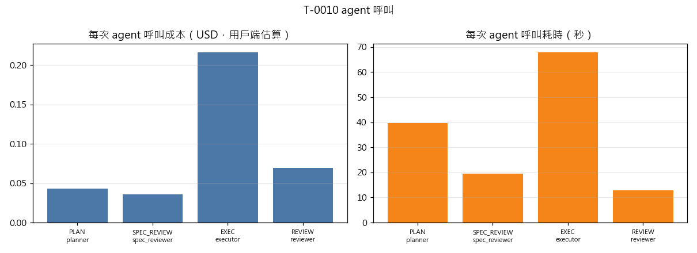
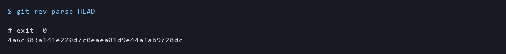
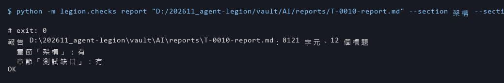

> [!warning] 草稿（AI 產生，未經核可）

# 開發紀錄：唯讀任務加入工具層限制與忽略目錄檢查（T-0010）

## 1. 文件資訊

| 欄位 | 內容 |
|---|---|
| 編號 | T-0010 |
| 任務 | 唯讀任務加入工具層限制與忽略目錄檢查 |
| 日期 | 2026-11-11 20:49:47 |
| 版本 | 0.4（step 8） |
| 狀態 | DONE |
| 文件狀態 | 草稿（AI 產生，未經核可） |
| 風險等級 | low |
| 成本（USD，用戶端估算） | 0.4178 |
| 人工介入次數 | 0 |
| 上層任務 | T-0008（深度 1） |

## 2. 目標與範圍

以下引自規格 `specs/T-0010.md`：

> # T-0010 唯讀審查：PipeAI_wmt 架構與測試缺口
>
> ## 目標
> 唯讀盤點 PipeAI_wmt 現況，產出報告（僅放在結構化輸出 report_md），含兩個必備章節：「架構」與「測試缺口」。同時作為唯讀工具層限制（Read/Grep/Glob）與前後比對的實測案例。
>
> ## 範圍
> - 只讀根目錄 `*.py`、`*.sh`、`data.yaml`、`03_docs/spec.md`、`99_bk/`。
> - 禁止遞迴掃描或讀取 `result/`、`annotated_images/`、`dataset/images`、`runs/`、`video/`。Glob 不要用根目錄 `*` 或 `**`，只用具體的檔名模式。
> - 不得讀 .env、金鑰、憑證。不寫任何檔案、不安裝、不執行訓練或推論。
>
> ## 報告內容
> 1. 架構：
>    - 主流程：影片 → YOLO → OCR → 合併 → CSV／標註影像。
>    - 各腳本職責與相依關係：easyocr、paddleocr、pytesseract 三套 OCR 並存。
>    - 路徑是否寫死 Linux 絕對路徑。
>    - `data.yaml` 已知問題（nc=33、train 與 val 相同、類別不平衡）。
>    - 每個發現附 `檔案:行號`。
> 2. 測試缺口：
>    - 目前有無任何測試（pytest）。
>    - 無法自動驗證的環節：OCR 距離解析、時間點與異常合併、CSV 編碼 utf-8-sig 與檔名慣例、類別重編。
>    - 建議的最小測試清單，並排優先順序。
>    - 每個發現附 `檔案:行號`。
>
> ## 驗收標準
> - runner 自動附加的 report 檢查通過：報告存在、含「架構」與「測試缺口」章節、長度足夠。
> - 目標 repo 執行前後 `git rev-parse HEAD` 與 `git status --porcelain` 相同（無修改）。
> - 每個發現附檔案:行號，由交付審查者人工審查。

## 3. 執行歷程

| # | 狀態 | 開始 | 結束 | 負責角色 | 模型 | agent 耗時（秒） |
|---|---|---|---|---|---|---|
| 1 | INBOX | 2026-11-11 20:49:47 | 2026-11-11 20:49:47 | Runner | — | — |
| 2 | PLAN | 2026-11-11 20:49:47 | 2026-11-11 20:51:18 | 指揮官（planner） | sonnet | 39.7 |
| 3 | SPEC_REVIEW | 2026-11-11 20:51:18 | 2026-11-11 20:52:07 | 規格審查者 | sonnet | 19.6 |
| 4 | GATE | 2026-11-11 20:52:07 | 2026-11-11 20:52:07 | Runner | — | — |
| 5 | EXEC | 2026-11-11 20:52:07 | 2026-11-11 20:54:45 | 指揮官（executor） | sonnet | 67.9 |
| 6 | VERIFY | 2026-11-11 20:54:45 | 2026-11-11 20:54:47 | Runner | — | — |
| 7 | REVIEW | 2026-11-11 20:54:47 | 2026-11-11 20:55:13 | 交付審查者 | sonnet | 12.8 |
| 8 | LEARN | 2026-11-11 20:55:13 | 2026-11-11 20:55:51 | 書記官 | sonnet | 17.8 |
| 9 | DONE | 2026-11-11 20:55:51 | — | — | — | — |

## 4. 設計與變更說明

### 4.1 流程圖（Mermaid）


*圖 1：本任務實際經過的狀態流程（Mermaid 轉圖）（E-014）*

Mermaid 原始碼：[E-013](evidence/E-013_flow_mermaid.mmd)

### 4.2 設計說明

T-0010 是唯讀審查任務：executor 只用 Read/Grep/Glob 盤點 PipeAI_wmt，報告只放在結構化輸出 report_md，不寫檔、不安裝、不跑訓練或推論。規格審查（E-001）判定通過，但提出建議：驗收無法證明沒有讀到禁止目錄，Grep 需一律帶 path，測試檢查的 Glob 模式要列進規格，「長度足夠」缺數字門檻。寫入保護靠工具層，不靠 git 比對（E-001）。流程為 PLAN、SPEC_REVIEW、EXEC、REVIEW 四步，成本與耗時見 E-011。

### 4.3 變更檔案與 diff 統計

```text
唯讀任務：無檔案變更。
```
來源：[E-009](evidence/E-009_verify1_diffstat.txt)

### 4.4 成本與耗時


*圖 2：各次 agent 呼叫的成本與耗時（E-012）*

資料來源：[E-011](evidence/E-011_runs_csv.csv)

## 5. 驗證證據

### 5.1 驗收標準 1：`git status --porcelain`

- 指令：`git status --porcelain`
- 結果：exit 0，通過（E-002）
- 原始檔：[E-002](evidence/E-002_verify1_c1.txt)


*圖 3：驗收標準 1 的終端輸出（E-003）*

**結論**：目標 repo 執行後 git status --porcelain 輸出為空，exit 0（E-002、E-003）。執行前後狀態比對均為 clean（E-008）。

### 5.2 驗收標準 2：`git rev-parse HEAD`

- 指令：`git rev-parse HEAD`
- 結果：exit 0，通過（E-004）
- 原始檔：[E-004](evidence/E-004_verify1_c2.txt)


*圖 4：驗收標準 2 的終端輸出（E-005）*

**結論**：HEAD 為 4a6c383a141e220d7c0eaea01d9e44afab9c28dc，exit 0（E-004、E-005）。執行前後 HEAD 相同，結果為 SAME（E-008）。唯讀任務無檔案變更（E-009）。

### 5.3 驗收標準 3：`python -m legion.checks report "D:/202611_agent-legion/vault/AI/reports/T-0010-report.md" --section 架構 --section 測試缺口`

- 指令：`python -m legion.checks report "D:/202611_agent-legion/vault/AI/reports/T-0010-report.md" --section 架構 --section 測試缺口`
- 結果：exit 0，通過（E-006）
- 原始檔：[E-006](evidence/E-006_verify1_c3.txt)


*圖 5：驗收標準 3 的終端輸出（E-007）*

**結論**：報告檢查通過：8121 字元、12 個標題，含「架構」與「測試缺口」章節，輸出 OK，exit 0（E-006、E-007）。

### 5.4 Runner 附加檢查

- 目標 repo 未被修改（HEAD 與 git status 相同）：通過（E-008）

## 6. 審查紀錄

### 6.1 規格審查

- 第 1 次結論：pass（E-001）
- 發現：建議：標題與目標說「作為唯讀工具層限制（Read/Grep/Glob）與前後比對的實測案例」，但驗收只驗證 repo 沒被修改與報告章節，驗證不了「沒有讀到 result/、annotated_images/、dataset/images、runs/、video/」。建議由 runner 或審查者檢查執行的工具呼叫紀錄（Glob/Grep/Read 的 path 與 pattern），並在驗收標準寫明。；建議：git status --porcelain 看不到被 .gitignore 排除的目錄（result/、runs/、dataset/ 等），所以這些目錄若被寫入就偵測不到。這個任務只讀，風險低。可補一句：寫入保護靠工具層，不靠 git 比對。；建議：範圍的 `*.py`、`*.sh` 只限根目錄，但 Grep 沒指定 path 時預設搜尋整個工作目錄，會進入禁止目錄。請寫明 Grep 一律帶 path（根目錄加 glob 如 `*.py`）或限定 99_bk/、03_docs/，並避免遞迴搜尋 data 與輸出目錄。；建議：測試缺口要說明有無 pytest 測試。確認的方法是 Glob `test_*.py`、`*_test.py`、`pytest.ini`、`pyproject.toml`、`conftest.py`，限根目錄，不用 `**`。請把這些模式列進規格。；建議：「長度足夠」的門檻沒有數字。同時建議把「每個發現附檔案:行號」改成報告內固定格式，例如 `path:line`，方便人工審查。；確認：03_docs/spec.md 與 99_bk/*.py 都存在，範圍可執行。提議的驗收指令（git status、git rev-parse）符合白名單，沒有 shell 符號。（E-001）
- 處置：放行（E-001）

**結論**：判定 pass（E-001）。確認 03_docs/spec.md 與 99_bk/*.py 存在、驗收指令符合白名單（E-001）。提出五項建議：驗收無法驗證未讀禁止目錄、git status 看不到被 ignore 的目錄、Grep 未帶 path 會掃整個工作目錄、需列出 pytest 檢查的 Glob 模式、長度門檻與 path:line 格式需明確（E-001）。這些建議均未阻擋。

### 6.2 交付審查

- 第 1 次結論：pass（E-010）
- 發現：通過：runner 檢查全過。報告有「架構」「測試缺口」章節，共 8121 字元。HEAD 為 4a6c383，執行前後相同，git status 前後皆 clean，也沒有檔案變更。；通過：我抽查了報告的行號引用，內容與原始碼相符。`data.yaml:3-4`（train 與 val 相同、Linux 絕對路徑）、`data.yaml:7`（nc: 33）、`train_yolov8_local.py:7,24-25,33`、`all_in_one_processing_bbox_easyocr.py:11,91,121,402,419,442`（import、解析函式、utf-8-sig、檔名）都對得上。；通過：報告涵蓋規格要求的內容。包含主流程、各腳本職責與相依、三套 OCR 並存、Linux 路徑寫死、data.yaml 問題、無 pytest、四類無法自動驗證的環節，以及 P0/P1/P2 的最小測試清單。每個發現都附檔案:行號。；通過：報告自述範圍，沒有讀禁止目錄、.env 或金鑰，也沒有寫檔、安裝或跑訓練推論。報告明確標示兩項未獨立驗證的內容：`99_bk/` 內檔案只確認存在，425/275 與各類別標註數取自 CLAUDE.md 與 spec.md。；建議（不阻擋）：測試缺口只 Glob 了 `test_*.py` 與 `conftest.py`。報告 2.1 與 1.2 已自承沒查 `*_test.py`、`pytest.ini`、`pyproject.toml`、`requirements.txt`、`tests/`。「沒有測試」的結論因此證據偏弱，後續應補查。；建議（不阻擋）：我沒有取得工具呼叫紀錄，無法確認有沒有碰禁止目錄，只能憑報告自述和 repo 前後比對。E-001 已指出這個缺口，應由 runner 保留 Glob/Grep/Read 的 path 與 pattern 紀錄。（E-010）
- 處置：放行（E-010）

**結論**：判定 pass（E-010）。審查者抽查 data.yaml、train_yolov8_local.py、all_in_one_processing_bbox_easyocr.py 的行號引用，與原始碼相符（E-010）。報告涵蓋規格要求的內容，並自承 99_bk/ 內檔案只確認存在，425/275 與各類別標註數取自 CLAUDE.md 與 spec.md（E-010）。兩項不阻擋建議：沒查 *_test.py、pytest.ini、pyproject.toml、tests/，「沒有測試」的證據偏弱；沒有工具呼叫紀錄，無法確認未碰禁止目錄（E-010）。

## 7. 問題與教訓

1. 工具呼叫紀錄缺口：spec_review 與 review 都指出無法驗證未讀禁止目錄，只能靠報告自述與 repo 前後比對（E-001、E-010）。
2. 「沒有測試」的結論只 Glob 了 test_*.py 與 conftest.py，其他模式未查，證據偏弱（E-010）。
3. 規格未寫明 Grep 一律帶 path、長度數字門檻與 path:line 固定格式（E-001）。
4. git 比對看不到被 ignore 的目錄，寫入保護需依賴工具層（E-001）。
5. 本次三項驗收與前後比對全數通過，repo 無變動（E-002、E-004、E-006、E-008）。

- 重試次數：0
- HALT 原因：無

## 8. 附錄：證據清冊

| 證據編號 | 檔名 | SHA-256 | 產生時間 | 產生者 |
|---|---|---|---|---|
| E-001 | evidence/E-001_spec_review.json | dcc48df406aa4a7a6fc9847dfd91009b1f45de2f3d6f585aacac683ea1205a98 | 2026-11-11 20:52:07 | runner（記錄 spec_review session c12d3e42-f270-4da3-a5aa-3f201bac1cc8） |
| E-002 | evidence/E-002_verify1_c1.txt | 1d90c57e3dd1d7f9c4f4d0e42f67e9f64413c1a7dcec919ea081e98c24305bca | 2026-11-11 20:54:47 | runner |
| E-003 | assets/E-003_verify1_c1_term.png | b1ae587dbecbec7fc850f05ce78ba8e7c22d6f1feaeef4a2a0785544a4db9d2f | 2026-11-11 20:54:47 | runner |
| E-004 | evidence/E-004_verify1_c2.txt | dc6157ca4ff444996536497c455d19e413d25e3c96288e083553a45f878467f8 | 2026-11-11 20:54:47 | runner |
| E-005 | assets/E-005_verify1_c2_term.png | 4f560b46e70aba779eda95810e123a178b81d2798fd3f4b835940f52893a966f | 2026-11-11 20:54:47 | runner |
| E-006 | evidence/E-006_verify1_c3.txt | 0fa54fd2a3d97ba1696ec2c2b8a8c7310b87639e58cd632787f507e9f40373a1 | 2026-11-11 20:54:47 | runner |
| E-007 | assets/E-007_verify1_c3_term.png | ad00de4b22cda64c20ad76b80001ed40dd1e06fb93f9966ce5c817ca05891797 | 2026-11-11 20:54:47 | runner |
| E-008 | evidence/E-008_verify1_outside.txt | 95a6e37f462a9216121c40ac2236e0b404ee5dc2bf2c8f958619e938dc6ca40d | 2026-11-11 20:54:47 | runner |
| E-009 | evidence/E-009_verify1_diffstat.txt | 3f89cd303e30076aab5471abd6c4c664af77bae992d98538f4a8e6c0144af8b3 | 2026-11-11 20:54:47 | runner |
| E-010 | evidence/E-010_review.json | 4c0f583ce288c16623ccc597c7ee628d3101c159391449e223d5b30d620aa1af | 2026-11-11 20:55:13 | runner（記錄 review session 0509bacb-e63b-4277-b36c-26d86ebf7a40） |
| E-011 | evidence/E-011_runs_csv.csv | d6fadefff746cf010fc7a33cf72768d673060ba1e33a84316d0126b091346fbc | 2026-11-11 20:55:31 | runner |
| E-012 | assets/E-012_runs_chart.png | 01580ff530a5a317d159f87569a2f18243ad14e244cf952211176c0961ba7bb5 | 2026-11-11 20:55:32 | runner |
| E-013 | evidence/E-013_flow_mermaid.mmd | 2a9fd9b5af9da1c0f238e5cf9c0320d353092b824a8712b8dcbe2cad3f054f18 | 2026-11-11 20:55:32 | runner |
| E-014 | assets/E-014_flow_mermaid_png.png | 575da105cb837c05a99479ab776f9ed52a19d6d136606ca5fe1fbdf1c5b57ba9 | 2026-11-11 20:55:33 | runner |
