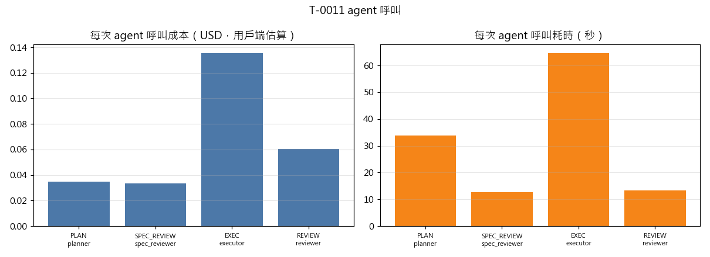
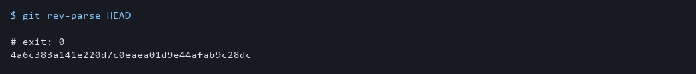
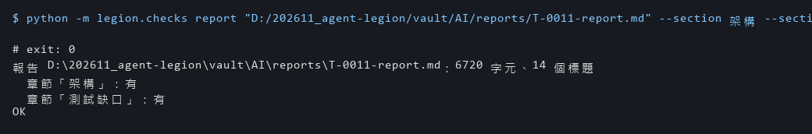

> [!warning] 草稿（AI 產生，未經核可）

# 開發紀錄：確認 legion.checks 的實際來源位置（T-0011）

## 1. 文件資訊

| 欄位 | 內容 |
|---|---|
| 編號 | T-0011 |
| 任務 | 確認 legion.checks 的實際來源位置 |
| 日期 | 2026-11-11 20:55:51 |
| 版本 | 0.4（step 8） |
| 狀態 | DONE |
| 文件狀態 | 草稿（AI 產生，未經核可） |
| 風險等級 | low |
| 成本（USD，用戶端估算） | 0.3204 |
| 人工介入次數 | 0 |
| 上層任務 | T-0009（深度 2） |

## 2. 目標與範圍

以下引自規格 `specs/T-0011.md`：

> ## T-0011 確認 legion.checks 的實際來源位置（readonly）
>
> ### 目標
> 查明 `python -m legion.checks` 實際載入的模組來源（E-004 可執行，E-008 稱找不到原始碼），作為後續實作任務的前置條件。
>
> ### 現況（規劃階段已讀）
> - D:\PipeAI_wmt 內（*.py/md/toml/cfg/txt/yaml）完全沒有 "legion" 字樣，所以 legion 套件不在目標 repo 內。它應該在 repo 外，例如 D:/202611_agent-legion、site-packages，或 editable install。
> - 工作目錄有 result/ 等大量檔案的資料夾，不可遞迴掃描。
>
> ### 範圍
> - 只讀，不寫任何檔案、不安裝、不連網。
> - 在工作目錄執行 `python -c "import legion.checks as m; print(m.__file__)"`，並印出 `legion.__file__`、`legion.__path__`、`sys.executable`、`sys.path`。
> - 用 `importlib.util.find_spec("legion.checks")` 取得 origin 與 submodule_search_locations。
> - 判斷來源型態：原始碼 .py、.pyc、zip／egg、editable install（.pth 或 finder）、namespace package，或 site-packages 內的已安裝套件。
> - 用 `pip show -f legion`（或 `importlib.metadata`）取得版本與安裝位置。
> - 若來源在 D:/202611_agent-legion 下，用 Read／Grep 只讀確認原始碼存在，並列出 checks 的入口（`__main__`／`report` 子指令）。
> - 判斷 E-008「找不到原始碼」的原因，例如搜尋範圍只含目標 repo，或套件是 editable／pyc-only。
> - 全程不得迴避 `result/`、`annotated_images/`、`dataset/images` 的限制：不得遞迴掃描。
>
> ### 報告（report_md）必須含章節
> - `## 架構`：legion.checks 的實際路徑、型態、安裝方式、import 解析鏈、模組結構，每個發現附 檔案:行號。
> - `## 測試缺口`：該模組有無測試、測試位置、缺少的覆蓋，以及實作任務前置條件的建議。
> - 另建議附上結論與 E-008 差異的解釋，以及未能確認之處。
>
> ### 驗收標準
> 1. 報告含「架構」「測試缺口」兩章節且長度足夠，由 runner 自動附加的 `legion.checks report` 檢查。
> 2. 報告明確給出 `legion.checks.__file__` 的實際值，或說明無法取得的原因。
> 3. 目標 repo 的 `git rev-parse HEAD` 與 `git status --porcelain` 執行前後一致（runner 比對）。
> 4. 每個發現附 檔案:行號（由人工審查）。

## 3. 執行歷程

| # | 狀態 | 開始 | 結束 | 負責角色 | 模型 | agent 耗時（秒） |
|---|---|---|---|---|---|---|
| 1 | INBOX | 2026-11-11 20:55:51 | 2026-11-11 20:55:51 | Runner | — | — |
| 2 | PLAN | 2026-11-11 20:55:51 | 2026-11-11 20:56:26 | 指揮官（planner） | sonnet | 33.9 |
| 3 | SPEC_REVIEW | 2026-11-11 20:56:26 | 2026-11-11 20:57:50 | 規格審查者 | sonnet | 12.7 |
| 4 | GATE | 2026-11-11 20:57:50 | 2026-11-11 20:58:16 | Runner | — | — |
| 5 | EXEC | 2026-11-11 20:58:16 | 2026-11-11 20:59:21 | 指揮官（executor） | sonnet | 64.6 |
| 6 | VERIFY | 2026-11-11 20:59:21 | 2026-11-11 21:00:52 | Runner | — | — |
| 7 | REVIEW | 2026-11-11 21:00:52 | 2026-11-11 21:01:07 | 交付審查者 | sonnet | 13.3 |
| 8 | LEARN | 2026-11-11 21:01:07 | 2026-11-11 21:01:55 | 書記官 | sonnet | 18.6 |
| 9 | DONE | 2026-11-11 21:01:55 | — | — | — | — |

## 4. 設計與變更說明

### 4.1 流程圖（Mermaid）


*圖 1：本任務實際經過的狀態流程（Mermaid 轉圖）（E-014）*

Mermaid 原始碼：[E-013](evidence/E-013_flow_mermaid.mmd)

### 4.2 設計說明

T-0011 為唯讀調查任務，目標是查明 `python -m legion.checks` 實際載入的來源。規格審查通過，但提出建議：驗收指令只能證明 repo 未被改動與章節齊全，驗證不了 __file__ 的正確性，這部分只能靠人工審查（E-001）。執行者產出的報告含「架構」「測試缺口」兩章節，共 6720 字元、14 個標題（E-006）。報告給的 `legion.checks` 路徑是靜態推定值 D:\202611_agent-legion\src\legion\checks.py，不是 runtime 輸出；原因是撰寫者沒有 shell，報告已在結論與「未能確認之處」明說（E-010）。對 E-008「找不到原始碼」的解釋是：搜尋範圍只含目標 repo，而 editable install 在 site-packages 只留 .pth（E-010）。報告把這個解釋標為「高度可能」，沒有當成已確認（E-010）。

### 4.3 變更檔案與 diff 統計

```text
唯讀任務：無檔案變更。
```
來源：[E-009](evidence/E-009_verify1_diffstat.txt)

### 4.4 成本與耗時


*圖 2：各次 agent 呼叫的成本與耗時（E-012）*

資料來源：[E-011](evidence/E-011_runs_csv.csv)

## 5. 驗證證據

### 5.1 驗收標準 1：`git status --porcelain`

- 指令：`git status --porcelain`
- 結果：exit 0，通過（E-002）
- 原始檔：[E-002](evidence/E-002_verify1_c1.txt)


*圖 3：驗收標準 1 的終端輸出（E-003）*

**結論**：在 D:\PipeAI_wmt 執行 exit 0，輸出為空，工作樹乾淨（E-002）。執行前後 status 都是 clean（E-008）。

### 5.2 驗收標準 2：`git rev-parse HEAD`

- 指令：`git rev-parse HEAD`
- 結果：exit 0，通過（E-004）
- 原始檔：[E-004](evidence/E-004_verify1_c2.txt)


*圖 4：驗收標準 2 的終端輸出（E-005）*

**結論**：exit 0，HEAD 為 4a6c383a141e220d7c0eaea01d9e44afab9c28dc（E-004）。執行前後 HEAD 相同，比對結果為 SAME（E-008）。唯讀任務無檔案變更（E-009）。

### 5.3 驗收標準 3：`python -m legion.checks report "D:/202611_agent-legion/vault/AI/reports/T-0011-report.md" --section 架構 --section 測試缺口`

- 指令：`python -m legion.checks report "D:/202611_agent-legion/vault/AI/reports/T-0011-report.md" --section 架構 --section 測試缺口`
- 結果：exit 0，通過（E-006）
- 原始檔：[E-006](evidence/E-006_verify1_c3.txt)


*圖 5：驗收標準 3 的終端輸出（E-007）*

**結論**：exit 0，輸出 OK。報告 6720 字元、14 個標題，「架構」「測試缺口」章節都存在（E-006）。這條只證明章節與長度合格，不證明 __file__ 的值正確。__file__ 一項由審查者人工判定為條件勉強達成（E-010）。

### 5.4 Runner 附加檢查

- 目標 repo 未被修改（HEAD 與 git status 相同）：通過（E-008）

## 6. 審查紀錄

### 6.1 規格審查

- 第 1 次結論：pass（E-001）
- 發現：建議：驗收指令（git status／rev-parse 加 runner 的 report 檢查）只能證明 repo 未被改動，以及報告章節和長度合格。它們驗證不了「legion.checks.__file__ 的實際值是否正確」。這部分只靠人工審查（標準 2、4）。可在報告要求附上原始指令輸出（__file__、find_spec origin、sys.executable）當證據，讓審查者能對照。；建議：python -c import 預設會寫 __pycache__，與「不寫任何檔案」略有衝突。執行時改用 `python -B`，或設 PYTHONDONTWRITEBYTECODE=1。若來源在 D:/202611_agent-legion，這樣也不會弄髒該目錄。；建議：標準 4 要求每個發現附「檔案:行號」，但 pip show、sys.path、find_spec 這類執行期輸出沒有行號。請改成「檔案發現附行號，執行期發現附指令與輸出」。；建議：請明說 python 必須是 runner 驗收時用的同一個直譯器或 venv。否則 `python -m legion.checks` 與專案的 `py -3.10` 或 venv 可能解析到不同的 legion。報告要記錄 sys.executable，並對照 `py -3.10` 的結果。；建議：若 legion 是 editable install，請補列要讀的 __editable__ finder 檔或 .pth 與 direct_url.json（都在 site-packages 內，範圍小，可讀）。測試缺口只在 D:/202611_agent-legion 下找 tests 目錄，不要遞迴掃描 PipeAI_wmt 的 result/、annotated_images/、dataset/images。；建議：「未能確認之處」建議列為必備小節。若 legion 不可 import，要寫出錯誤訊息，並說明這會影響 runner 的 report 檢查。（E-001）
- 處置：放行（E-001）

**結論**：判定 pass，附 6 條建議，沒有必修項（E-001）。建議包括：驗收指令無法驗證 __file__ 的實際值，需靠人工審查；改用 python -B 避免寫 __pycache__；執行期發現改附指令與輸出，不用行號；記錄 sys.executable 並對照 py -3.10；若為 editable install，應讀 .pth 與 direct_url.json；「未能確認之處」列為必備小節（E-001）。

### 6.2 交付審查

- 第 1 次結論：pass（E-010）
- 發現：驗收 1（報告章節）：E-006 顯示「架構」「測試缺口」章節都有，6720 字元，exit 0。；驗收 3（repo 未被改動）：E-008 顯示執行前後 HEAD 同為 4a6c383，status 都是 clean。E-009 確認無檔案變更。；驗收 2（__file__ 實際值）：條件勉強達成。報告給的是推定值 D:\202611_agent-legion\src\legion\checks.py，不是 runtime 輸出。報告在結論第 4 行與「未能確認之處」明說原因是撰寫者沒有 shell。規格允許「說明無法取得的原因」，所以算通過。但 T-0011 的核心目標（查明實際載入的模組來源）只做到靜態推論，後續實作任務前，應在有 shell 的環境補跑報告第 91-95 行列的指令。；驗收 4（檔案:行號）：我抽查的內容屬實。.venv\Lib\site-packages 下用 *legion* 搜尋只有 __editable__.legion-0.4.0.pth。checks.py 的 check_report 在第 166 行，main 在第 186 行，report 子指令在第 194 行，__main__ 判斷在第 216 行，都與報告所述一致。報告的 .pth 檔名、版本、各檔案行號引用格式正確。；E-008 差異的解釋合理（搜尋範圍只含目標 repo，加上 editable install 在 site-packages 只留 .pth）。它也把這個推定標明為「高度可能」，沒有說成已確認。；報告沒有 python -B／sys.executable 與 py -3.10 的對照，因為沒有執行。這點已列入「未能確認之處」，是已知缺口，不影響本次交付。；報告遵守了限制：沒有掃描 result/、annotated_images/、dataset/images，也沒有寫入或安裝任何東西。（E-010）
- 處置：放行（E-010）

**結論**：判定 pass（E-010）。章節檢查通過（E-006）。repo 未被改動（E-008、E-009）。驗收 2 的 __file__ 只是推定值，不是 runtime 輸出，審查者判為「勉強達成」，因為規格允許說明無法取得的原因（E-010）。審查者抽查的行號屬實：check_report 在第 166 行，main 在第 186 行，report 子指令在第 194 行，__main__ 判斷在第 216 行（E-010）。site-packages 下只找到 __editable__.legion-0.4.0.pth（E-010）。報告沒有 sys.executable 與 py -3.10 的對照，已列為已知缺口（E-010）。報告沒有掃描受限目錄（E-010）。

## 7. 問題與教訓

1. 核心目標只做到靜態推論：撰寫者沒有 shell，__file__、find_spec、sys.executable 都沒有實際輸出（E-010）。後續實作任務前仍需補跑。
2. 驗收指令沒有覆蓋「事實是否正確」。三條指令只驗 repo 未動與章節齊全（E-002、E-004、E-006），正確性只靠人工審查（E-001、E-010）。
3. 規格審查提出的建議（python -B、py -3.10 對照）沒有進入執行，因為沒有 shell（E-001、E-010）。
4. 成本方面：四次 agent 呼叫中以 executor 最高，約 0.135 美元、64.6 秒（E-011）。

- 重試次數：0
- HALT 原因：無
- followup_dropped：深度 3 超過上限 2：補跑 legion.checks 來源的 runtime 驗證
- followup_dropped：深度 3 超過上限 2：為 legion.checks 補測試缺口評估

## 8. 附錄：證據清冊

| 證據編號 | 檔名 | SHA-256 | 產生時間 | 產生者 |
|---|---|---|---|---|
| E-001 | evidence/E-001_spec_review.json | 62f12239186737e573c78751c25fcb3f1bf7576350d1db349db4970fa3f1b8f0 | 2026-11-11 20:57:50 | runner（記錄 spec_review session 60825ca7-0d9c-4716-8798-2ceadade73e7） |
| E-002 | evidence/E-002_verify1_c1.txt | 1d90c57e3dd1d7f9c4f4d0e42f67e9f64413c1a7dcec919ea081e98c24305bca | 2026-11-11 21:00:52 | runner |
| E-003 | assets/E-003_verify1_c1_term.png | b1ae587dbecbec7fc850f05ce78ba8e7c22d6f1feaeef4a2a0785544a4db9d2f | 2026-11-11 21:00:52 | runner |
| E-004 | evidence/E-004_verify1_c2.txt | dc6157ca4ff444996536497c455d19e413d25e3c96288e083553a45f878467f8 | 2026-11-11 21:00:52 | runner |
| E-005 | assets/E-005_verify1_c2_term.png | 4f560b46e70aba779eda95810e123a178b81d2798fd3f4b835940f52893a966f | 2026-11-11 21:00:52 | runner |
| E-006 | evidence/E-006_verify1_c3.txt | 86b361eb37029573101130a52ab5eb9292479293d37fafca12086a8a75438fd3 | 2026-11-11 21:00:52 | runner |
| E-007 | assets/E-007_verify1_c3_term.png | 9b6f557457862af2dcaf0b0ead0836a7e448b2240cb57eb45b24b9c7715fbb44 | 2026-11-11 21:00:52 | runner |
| E-008 | evidence/E-008_verify1_outside.txt | 95a6e37f462a9216121c40ac2236e0b404ee5dc2bf2c8f958619e938dc6ca40d | 2026-11-11 21:00:52 | runner |
| E-009 | evidence/E-009_verify1_diffstat.txt | 3f89cd303e30076aab5471abd6c4c664af77bae992d98538f4a8e6c0144af8b3 | 2026-11-11 21:00:52 | runner |
| E-010 | evidence/E-010_review.json | 27da83bb6b42c98cf7104db95e9bf08ea1758d95062b2d5798a15880a0007b4b | 2026-11-11 21:01:07 | runner（記錄 review session 30eedf6f-5fa5-4abc-ab00-14d04476e756） |
| E-011 | evidence/E-011_runs_csv.csv | 79ee2e28e13f269205054c8944cc8a9887646571821a37b94919689a1121535c | 2026-11-11 21:01:33 | runner |
| E-012 | assets/E-012_runs_chart.png | fdcb49b9ce5281f01ef7f13cbb485969582e219981d4169ca87eb4920c9a9fa3 | 2026-11-11 21:01:34 | runner |
| E-013 | evidence/E-013_flow_mermaid.mmd | 2a9fd9b5af9da1c0f238e5cf9c0320d353092b824a8712b8dcbe2cad3f054f18 | 2026-11-11 21:01:34 | runner |
| E-014 | assets/E-014_flow_mermaid_png.png | f0c3ed66092b6790d32f822a0c4a9ce7ff816d7f18d1bcecef9916289cb13322 | 2026-11-11 21:01:37 | runner |
