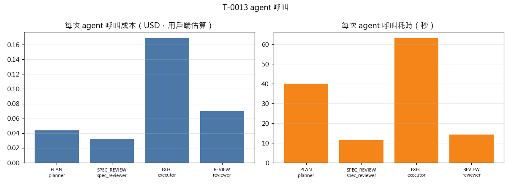
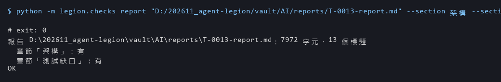

> [!warning] 草稿（AI 產生，未經核可）

# 開發紀錄：runner 保留唯讀任務的工具呼叫紀錄（T-0013）

## 1. 文件資訊

| 欄位 | 內容 |
|---|---|
| 編號 | T-0013 |
| 任務 | runner 保留唯讀任務的工具呼叫紀錄 |
| 日期 | 2026-11-11 20:55:51 |
| 版本 | 0.4（step 8） |
| 狀態 | DONE |
| 文件狀態 | 草稿（AI 產生，未經核可） |
| 風險等級 | low |
| 成本（USD，用戶端估算） | 0.3683 |
| 人工介入次數 | 0 |
| 上層任務 | T-0010（深度 2） |

## 2. 目標與範圍

以下引自規格 `specs/T-0013.md`：

> # T-0013 規格（readonly）
>
> ## 背景與範圍說明
> 想法是「runner 記錄唯讀任務的 Glob/Grep/Read 呼叫並檢查是否碰到禁止目錄」。這項改動屬於 runner（`D:/202611_agent-legion`），不在本工作目錄 `D:\PipeAI_wmt`，而本任務是唯讀，所以不能在這裡實作。
> 本任務在 PipeAI_wmt 內做唯讀盤點，並要求執行者自己附上工具呼叫紀錄，作為 E-001、E-010 缺少的證據。runner 端的實作建議另開 write 任務，目標 repo 為 agent-legion。
>
> ## 目標
> 產出 PipeAI_wmt 的現況報告，放在結構化輸出的 `report_md`。執行者不寫任何檔案。
>
> ## 報告必備章節（標題需完全一致）
> 1. `## 架構`：主要腳本與資料流（影片 → YOLO → OCR → CSV／標註影像）、模型與資料位置、Linux／Windows 路徑相依點。每個發現附 `檔案:行號`。
> 2. `## 測試缺口`：現有測試（若有）、沒有測試保護的模組與風險（OCR 解析、CSV 編碼 utf-8-sig、檔名格式、路徑寫死），並提出優先補測清單。每個發現附 `檔案:行號`。
> 3. `## 工具呼叫紀錄`：逐筆列出每次 Glob/Grep/Read 的工具、path、pattern，以表格呈現。
> 4. `## 禁止目錄檢查`：逐筆對照紀錄，說明沒有任何呼叫碰到 `result/`、`annotated_images/`、`dataset/images`、`runs/`、`video/`。若有碰到，必須明說並解釋原因。
> 5. `## runner 建議`：簡述 runner 該如何記錄與檢查（紀錄欄位、路徑正規化後比對禁止清單、通過／失敗判定），供後續 write 任務使用。
>
> ## 限制
> - 不得遞迴掃描根目錄，因為 `result/` 約 150 萬檔，`Glob "*"` 或 `**/*` 會逾時。只能對具體檔案與 `03_docs/` 等小目錄操作。要找 `.py` 請用 `*.py`，且 `path` 指到根目錄並限定單層。
> - 不得讀 `.env`、金鑰、憑證。
> - 不得修改、刪除、安裝、push、merge 或對外發送。
>
> ## 驗收標準
> - runner 自動附加的 `legion.checks report`（章節「架構」「測試缺口」齊全、長度足夠）通過。
> - 目標 repo 執行前後 `git rev-parse HEAD` 與 `git status --porcelain` 不變。
> - 人工審查：每個發現有 `檔案:行號`，工具呼叫紀錄完整，禁止目錄檢查與紀錄一致。

## 3. 執行歷程

| # | 狀態 | 開始 | 結束 | 負責角色 | 模型 | agent 耗時（秒） |
|---|---|---|---|---|---|---|
| 1 | INBOX | 2026-11-11 20:55:51 | 2026-11-11 20:55:51 | Runner | — | — |
| 2 | PLAN | 2026-11-11 20:55:51 | 2026-11-11 20:57:21 | 指揮官（planner） | sonnet | 40.1 |
| 3 | SPEC_REVIEW | 2026-11-11 20:57:21 | 2026-11-11 20:58:09 | 規格審查者 | sonnet | 11.5 |
| 4 | GATE | 2026-11-11 20:58:09 | 2026-11-11 20:58:16 | Runner | — | — |
| 5 | EXEC | 2026-11-11 20:58:16 | 2026-11-11 21:00:25 | 指揮官（executor） | sonnet | 63.0 |
| 6 | VERIFY | 2026-11-11 21:00:25 | 2026-11-11 21:00:53 | Runner | — | — |
| 7 | REVIEW | 2026-11-11 21:00:53 | 2026-11-11 21:01:22 | 交付審查者 | sonnet | 14.3 |
| 8 | LEARN | 2026-11-11 21:01:22 | 2026-11-11 21:02:14 | 書記官 | sonnet | 17.2 |
| 9 | DONE | 2026-11-11 21:02:14 | — | — | — | — |

## 4. 設計與變更說明

### 4.1 流程圖（Mermaid）


*圖 1：本任務實際經過的狀態流程（Mermaid 轉圖）（E-012）*

Mermaid 原始碼：[E-011](evidence/E-011_flow_mermaid.mmd)

### 4.2 設計說明

本任務為唯讀盤點。規格說明 runner 端改動屬 agent-legion repo，不在 PipeAI_wmt 內實作，因此改為要求執行者在報告中自附工具呼叫紀錄，補足 E-001、E-010 缺少的證據。規格審查通過（E-001），但提出數項建議：工具呼叫紀錄由執行者自報、無外部資料可核對；只有「架構」「測試缺口」兩章有程式檢查；Grep 的 path 與 glob 也要限制，不可指到根目錄。執行者只用 sonnet 一次 EXEC 完成（E-009）。報告共 7972 字元、13 個標題（E-004）。

### 4.3 變更檔案與 diff 統計

```text
唯讀任務：無檔案變更。
```
來源：[E-007](evidence/E-007_verify1_diffstat.txt)

### 4.4 成本與耗時


*圖 2：各次 agent 呼叫的成本與耗時（E-010）*

資料來源：[E-009](evidence/E-009_runs_csv.csv)

## 5. 驗證證據

### 5.1 驗收標準 1：`git status --porcelain`

- 指令：`git status --porcelain`
- 結果：exit 0，通過（E-002）
- 原始檔：[E-002](evidence/E-002_verify1_c1.txt)


*圖 3：驗收標準 1 的終端輸出（E-003）*

**結論**：通過。輸出為空，exit 0（E-002）。目標 repo 執行前後 HEAD 皆為 4a6c383a141e220d7c0eaea01d9e44afab9c28dc，status 皆為 clean，結果為 SAME（E-006）。唯讀任務沒有檔案變更（E-007）。

### 5.2 驗收標準 2：`python -m legion.checks report "D:/202611_agent-legion/vault/AI/reports/T-0013-report.md" --section 架構 --section 測試缺口`

- 指令：`python -m legion.checks report "D:/202611_agent-legion/vault/AI/reports/T-0013-report.md" --section 架構 --section 測試缺口`
- 結果：exit 0，通過（E-004）
- 原始檔：[E-004](evidence/E-004_verify1_c2.txt)


*圖 4：驗收標準 2 的終端輸出（E-005）*

**結論**：通過。exit 0，報告 7972 字元、13 個標題，「架構」「測試缺口」章節皆存在，輸出 OK（E-004）。

### 5.3 Runner 附加檢查

- 目標 repo 未被修改（HEAD 與 git status 相同）：通過（E-006）

## 6. 審查紀錄

### 6.1 規格審查

- 第 1 次結論：pass（E-001）
- 發現：建議：「工具呼叫紀錄」是執行者自己回報，沒有外部資料可核對。目前只靠人工比對。後續 write 任務若實作 runner 紀錄，才能補上自動驗證。可在報告中註明這項限制。；建議：runner 自動附加的 legion.checks 只檢查「架構」「測試缺口」兩章。「工具呼叫紀錄」「禁止目錄檢查」「runner 建議」三章沒有程式檢查，完全依賴人工審查。可要求人工審查時逐項確認這三章存在。；建議：限制只明說 Glob 要用 `*.py` 並限定單層。Grep 也要明寫：path 必須是具體檔案或 03_docs/，不可指到根目錄，否則會遞迴進入 result/。Grep 的 glob 參數同樣不能用 `**`。；建議：「模型與資料位置」需要提到 runs/、best.pt、dataset/images。這些目錄屬禁止讀取範圍，執行者只能引用 CLAUDE.md 或腳本中的路徑字串，不可實際列出內容。這類發現的 `檔案:行號` 應指向腳本或 CLAUDE.md。；建議：讀 CLAUDE.md 與 03_docs/spec.md 也算 Read 呼叫，需列入紀錄表。可明寫「每一次 Read／Glob／Grep 都要列，包括失敗的呼叫」。；建議：驗收指令只有 `git status --porcelain`，沒有記錄 HEAD。runner 會另外比對 HEAD，所以這不影響通過。可再加 `git rev-parse HEAD` 讓驗收更完整。（E-001）
- 處置：放行（E-001）

**結論**：判定 pass，附六項建議（E-001）：工具呼叫紀錄為自報、缺外部核對；後三章無程式檢查；Grep 路徑與 glob 限制需明寫；模型與資料位置只能引用腳本或 CLAUDE.md 的路徑字串；失敗的呼叫也要列入紀錄；驗收可加 git rev-parse HEAD。這些都是建議，不是必修。

### 6.2 交付審查

- 第 1 次結論：pass（E-008）
- 發現：驗收通過：legion.checks report 通過（E-004，「架構」「測試缺口」齊全，7972 字元）。目標 repo 的 HEAD 與 status 前後相同（E-006），且無檔案變更（E-007）。；五個必備章節標題都存在且與規格一致。「工具呼叫紀錄」以表格列出 13 筆 Glob/Grep/Read，包含 tool、path、pattern。；我抽查了報告引用的行號，全部吻合：easyocr.py:91、235、255、402、419、442，以及 train_yolov8_local.py:7、24。各發現都附 `檔案:行號`。；「禁止目錄檢查」如實承認 Glob #4（`*.yaml`）回傳了 `runs\detect\train\args.yaml` 與 `train2\args.yaml`，也就是碰到 runs/。報告說明原因是 Glob 不限單層，並指出沒有 Read 這些檔案。這符合規格「若有碰到，必須明說並解釋原因」。報告也承認無法排除 Glob 走訪過 result/。報告沒有宣稱全部乾淨。；這次碰到 runs/ 是規格自己指定的做法（要求以 `*.py` 找檔）和 Glob 實際行為之間的落差造成的，不是執行者違規。報告沒有讀取 runs/ 的內容。建議人工審查時確認這一點可接受。；限制：工具呼叫紀錄由執行者自己回報，沒有外部資料可核對（E-001 也提到）。以下三章沒有程式檢查，只能靠人工審查：「工具呼叫紀錄」「禁止目錄檢查」「runner 建議」。；「runner 建議」內容完整：紀錄欄位、路徑正規化後比對、通過／警告／失敗判定、交叉驗證。報告還補上一點：要記錄回傳路徑並一併比對。這正是這次發現的缺口。；後續 write 任務應修正規格：改用單層列舉的方式（不要用 Glob 找副檔名），並規定 Grep 的 path 不可指到根目錄。（E-008）
- 處置：放行（E-008）

**結論**：判定 pass（E-008）。審查者確認驗收通過（E-004、E-006、E-007），五個必備章節齊全，工具呼叫紀錄表列 13 筆，並抽查行號全部吻合。報告如實承認 Glob #4（*.yaml）回傳 runs 下的 args.yaml，也就是碰到 runs/，原因是 Glob 不限單層，且沒有 Read 這些檔案（E-008）。報告也承認無法排除 Glob 走訪過 result/（E-008）。審查者認為這是規格做法與 Glob 實際行為的落差，不是執行者違規，並建議人工確認可接受（E-008）。紀錄由執行者自報、後三章無程式檢查，仍須靠人工審查（E-008）。

## 7. 問題與教訓

1. 規格要求以 Glob 的 *.py 找檔並「限定單層」，但 Glob 實際不限單層，導致碰到 runs/（E-008）。規格寫的限制要能被工具實際行為保證。
2. 工具呼叫紀錄只能由執行者自報，沒有外部資料可核對（E-001、E-008），本任務無法自動驗證「禁止目錄檢查」。
3. 程式檢查只涵蓋兩章（E-004），其餘三章靠人工（E-001、E-008）。
4. 無法確認 Glob 是否走訪過 result/（E-008），逾時風險未被排除。

- 重試次數：0
- HALT 原因：無
- followup_dropped：深度 3 超過上限 2：runner 記錄唯讀任務工具呼叫並比對禁止目錄
- followup_dropped：深度 3 超過上限 2：擴充 legion.checks 檢查唯讀報告的必備章節

## 8. 附錄：證據清冊

| 證據編號 | 檔名 | SHA-256 | 產生時間 | 產生者 |
|---|---|---|---|---|
| E-001 | evidence/E-001_spec_review.json | 74483d652f0e5d223e95d3493a1bbff47aa09b710908dc073ec2354232dc3c49 | 2026-11-11 20:58:09 | runner（記錄 spec_review session 456a46bb-c937-4d2f-ad28-87a4427d6fad） |
| E-002 | evidence/E-002_verify1_c1.txt | 1d90c57e3dd1d7f9c4f4d0e42f67e9f64413c1a7dcec919ea081e98c24305bca | 2026-11-11 21:00:52 | runner |
| E-003 | assets/E-003_verify1_c1_term.png | b1ae587dbecbec7fc850f05ce78ba8e7c22d6f1feaeef4a2a0785544a4db9d2f | 2026-11-11 21:00:52 | runner |
| E-004 | evidence/E-004_verify1_c2.txt | 8615ee0137201235eeec69b6a006fcb6a21432507beebfdf9de050dc3b12e3fb | 2026-11-11 21:00:53 | runner |
| E-005 | assets/E-005_verify1_c2_term.png | 2b2469d0909e8b6d3e4caf3fd35fb978c9e7a659fc632ce6746c1d414e17fef1 | 2026-11-11 21:00:53 | runner |
| E-006 | evidence/E-006_verify1_outside.txt | 95a6e37f462a9216121c40ac2236e0b404ee5dc2bf2c8f958619e938dc6ca40d | 2026-11-11 21:00:53 | runner |
| E-007 | evidence/E-007_verify1_diffstat.txt | 3f89cd303e30076aab5471abd6c4c664af77bae992d98538f4a8e6c0144af8b3 | 2026-11-11 21:00:53 | runner |
| E-008 | evidence/E-008_review.json | a1c53bbf4f58e73570b8ed6a195ddc52bf12c200b89c42f16be8aa7f5f40bdb2 | 2026-11-11 21:01:22 | runner（記錄 review session 6dcb9ad0-400c-4a9f-981b-ca7d15477e49） |
| E-009 | evidence/E-009_runs_csv.csv | 203f106726353a5f3d25d4cc94a47e04a4018e1269e2fa33f7f26eb96daf8816 | 2026-11-11 21:01:55 | runner |
| E-010 | assets/E-010_runs_chart.png | 83cd44e62e39846449da06a4605197e29d4ce8de1b3b4f9fa04d663b15c203a4 | 2026-11-11 21:01:55 | runner |
| E-011 | evidence/E-011_flow_mermaid.mmd | 2a9fd9b5af9da1c0f238e5cf9c0320d353092b824a8712b8dcbe2cad3f054f18 | 2026-11-11 21:01:55 | runner |
| E-012 | assets/E-012_flow_mermaid_png.png | 9f78019cb7a95608db86f840036c7e91ae533d273b599c80bd95a8563fdbe405 | 2026-11-11 21:01:57 | runner |
