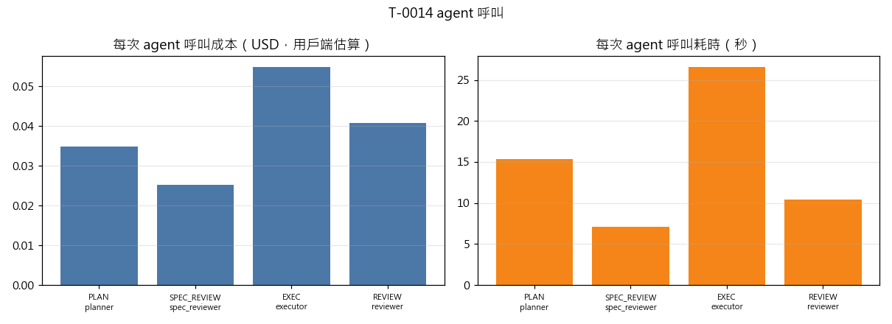
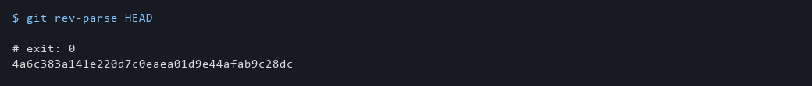
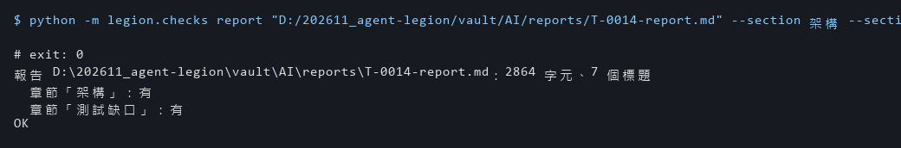

> [!warning] 草稿（AI 產生，未經核可）

# 開發紀錄：補查 PipeAI_wmt 測試檔案（T-0014）

## 1. 文件資訊

| 欄位 | 內容 |
|---|---|
| 編號 | T-0014 |
| 任務 | 補查 PipeAI_wmt 測試檔案 |
| 日期 | 2026-11-11 20:55:51 |
| 版本 | 0.4（step 8） |
| 狀態 | DONE |
| 文件狀態 | 草稿（AI 產生，未經核可） |
| 風險等級 | low |
| 成本（USD，用戶端估算） | 0.2033 |
| 人工介入次數 | 0 |
| 上層任務 | T-0010（深度 2） |

## 2. 目標與範圍

以下引自規格 `specs/T-0014.md`：

> ## T-0014 補查 PipeAI_wmt 測試檔案（readonly）
>
> ### 目標
> 以限根目錄（不遞迴進 result/、annotated_images/、dataset/）的 Glob 補強 T-0010 結論「專案沒有測試」之證據（E-010）。
>
> ### 規劃階段已查（根目錄 Glob）
> - `*_test.py`、`test_*.py`：無
> - `pytest.ini`、`pyproject.toml`、`requirements.txt`、`setup.cfg`、`tox.ini`、`conftest.py`：無
> - `tests/*`：無
> - 根目錄 `*.py` 僅 5 支主腳本：train_yolov8_local.py、save_annotated_images.py、inference_video.py、all_in_one_processing_bbox_ocr_cloaud.py、all_in_one_processing_bbox_easyocr.py；另 99_bk/ 有 2 支舊版。
>
> ### 範圍
> - 執行者重跑上述 Glob（根目錄限定），另可 Glob `99_bk/*`、`03_docs/*`、`02_data/*` 確認有無測試相關檔；可 Grep 根目錄 *.py 搜尋 `import pytest|unittest|def test_` 以確認腳本內無內嵌測試。
> - 不得遞迴讀取 result/、annotated_images/、dataset/images；不寫檔、不安裝、不讀 .env／金鑰。
>
> ### 報告（report_md）須含章節
> `## 架構`（根目錄腳本與資料夾概況、依賴宣告方式）與 `## 測試缺口`（每項查詢指令/pattern、結果、結論；缺口與建議）。每項發現附 檔案:行號（Grep 內容）或 Glob pattern＋結果。
>
> ### 驗收標準
> 1. 報告存在且章節「架構」「測試缺口」齊全（runner 自動附加檢查）。
> 2. 報告明列各 pattern 的查詢結果，並明確下結論（沒有測試／有哪些），說明證據範圍限於根目錄及指定子資料夾。
> 3. 目標 repo 的 HEAD 與 git status 前後不變。

## 3. 執行歷程

| # | 狀態 | 開始 | 結束 | 負責角色 | 模型 | agent 耗時（秒） |
|---|---|---|---|---|---|---|
| 1 | INBOX | 2026-11-11 20:55:51 | 2026-11-11 20:55:51 | Runner | — | — |
| 2 | PLAN | 2026-11-11 20:55:51 | 2026-11-11 20:57:37 | 指揮官（planner） | sonnet | 15.4 |
| 3 | SPEC_REVIEW | 2026-11-11 20:57:37 | 2026-11-11 20:58:16 | 規格審查者 | sonnet | 7.1 |
| 4 | GATE | 2026-11-11 20:58:16 | 2026-11-11 20:58:16 | Runner | — | — |
| 5 | EXEC | 2026-11-11 20:58:16 | 2026-11-11 21:00:51 | 指揮官（executor） | sonnet | 26.6 |
| 6 | VERIFY | 2026-11-11 21:00:51 | 2026-11-11 21:00:54 | Runner | — | — |
| 7 | REVIEW | 2026-11-11 21:00:54 | 2026-11-11 21:01:32 | 交付審查者 | sonnet | 10.4 |
| 8 | LEARN | 2026-11-11 21:01:32 | 2026-11-11 21:02:31 | 書記官 | sonnet | 15.1 |
| 9 | DONE | 2026-11-11 21:02:31 | — | — | — | — |

## 4. 設計與變更說明

### 4.1 流程圖（Mermaid）


*圖 1：本任務實際經過的狀態流程（Mermaid 轉圖）（E-014）*

Mermaid 原始碼：[E-013](evidence/E-013_flow_mermaid.mmd)

### 4.2 設計說明

本任務為唯讀補查：以根目錄限定的 Glob／Grep 補強 T-0010「專案沒有測試」的結論。規格審查（E-001）判定通過，並建議限縮 Grep 範圍、涵蓋更多依賴宣告檔、區分自動化測試與手動驗證。流程為 PLAN、SPEC_REVIEW、EXEC、REVIEW 各一次（E-011），未發生退回。執行者只讀不寫，目標 repo 前後 HEAD 與 status 相同（E-008），diff 為空（E-009）。

### 4.3 變更檔案與 diff 統計

```text
唯讀任務：無檔案變更。
```
來源：[E-009](evidence/E-009_verify1_diffstat.txt)

### 4.4 成本與耗時


*圖 2：各次 agent 呼叫的成本與耗時（E-012）*

資料來源：[E-011](evidence/E-011_runs_csv.csv)

## 5. 驗證證據

### 5.1 驗收標準 1：`git status --porcelain`

- 指令：`git status --porcelain`
- 結果：exit 0，通過（E-002）
- 原始檔：[E-002](evidence/E-002_verify1_c1.txt)


*圖 3：驗收標準 1 的終端輸出（E-003）*

**結論**：輸出為空、exit 0（E-002）；前後比對皆為 clean，結果 SAME（E-008），目標 repo 未被修改。

### 5.2 驗收標準 2：`git rev-parse HEAD`

- 指令：`git rev-parse HEAD`
- 結果：exit 0，通過（E-004）
- 原始檔：[E-004](evidence/E-004_verify1_c2.txt)


*圖 4：驗收標準 2 的終端輸出（E-005）*

**結論**：HEAD 為 4a6c383a141e220d7c0eaea01d9e44afab9c28dc、exit 0（E-004）；執行前後相同（E-008）。

### 5.3 驗收標準 3：`python -m legion.checks report "D:/202611_agent-legion/vault/AI/reports/T-0014-report.md" --section 架構 --section 測試缺口`

- 指令：`python -m legion.checks report "D:/202611_agent-legion/vault/AI/reports/T-0014-report.md" --section 架構 --section 測試缺口`
- 結果：exit 0，通過（E-006）
- 原始檔：[E-006](evidence/E-006_verify1_c3.txt)


*圖 5：驗收標準 3 的終端輸出（E-007）*

**結論**：報告 2864 字元、7 個標題，「架構」「測試缺口」章節皆有，輸出 OK、exit 0（E-006）。此檢查只驗章節與長度，內容品質由審查判斷（E-001、E-010）。

### 5.4 Runner 附加檢查

- 目標 repo 未被修改（HEAD 與 git status 相同）：通過（E-008）

## 6. 審查紀錄

### 6.1 規格審查

- 第 1 次結論：pass（E-001）
- 發現：建議：驗收指令 git status --porcelain 與 git rev-parse HEAD 只有輸出、無預期值；runner 雖會比對前後，建議規格註明「前後輸出需一致（status 為空）」。；建議：Grep 範圍請明寫為根目錄 *.py（glob="*.py"，不遞迴）並加 99_bk/*.py，避免 Grep 預設遞迴進 result/、annotated_images/、dataset/。可用 path 指定檔案或 glob 限制 depth（例如分別對 99_bk 與根目錄 Glob 後逐檔 Grep）。；建議：Glob 根目錄時 pattern 不要用 **；用 *.py、tests/*、99_bk/*、03_docs/*、02_data/* 等單層樣式。02_data/ 若含大量檔案，僅看檔名清單。；建議：「無依賴宣告檔」之結論需涵蓋 requirements*.txt、environment.yml、Pipfile、setup.py 等，並提及 .sh 腳本內是否有 pip install；範圍說明需註明證據限於根目錄與指定子資料夾，不能推論 runs/ 等其他處。；建議：報告須區分「沒有自動化測試」與「有手動驗證腳本」（如 save_annotated_images.py、yolo val 指令），並把 CLAUDE.md 的驗證指令列為既有驗證手段。；建議：「章節齊全」檢查只驗章節標題與長度，內容品質靠人工審查；可接受。（E-001）
- 處置：放行（E-001）

**結論**：判定 pass（E-001）。提出的建議包括：註明前後輸出需一致、Grep 限縮為根目錄 *.py 與 99_bk、Glob 用單層樣式、涵蓋 requirements*.txt／environment.yml／Pipfile／setup.py 與 .sh 內 pip install、區分自動化測試與手動驗證。這些都屬建議，並非必修。

### 6.2 交付審查

- 第 1 次結論：pass（E-010）
- 發現：驗收 1：報告存在，「架構」「測試缺口」章節齊全（E-006 OK，2864 字元）。；驗收 2：報告列出 9 項 Glob／Grep 查詢及各自結果，結論明確為「專案沒有測試」，並說明證據範圍限於根目錄、99_bk、03_docs、02_data 與 *.py 內容。我另以根目錄 Glob `*test*` 重查，結果為無檔案，與報告一致。；驗收 3：目標 repo 的 HEAD 前後皆為 4a6c383，git status 前後皆為 clean（E-008 SAME），diff 為空，符合唯讀要求。；報告已採納規格審查的建議：涵蓋 requirements*.txt、environment.yml、Pipfile、setup.py 等依賴宣告檔，並寫明證據限制。；輕微缺漏：報告未區分「沒有自動化測試」與「既有手動驗證手段」（例如 CLAUDE.md 的 `yolo val model=best.pt data=data.yaml`、`save_annotated_images.py`），不影響驗收。；輕微缺漏：報告承認 .sh 腳本內有無 pip install 未查驗，也承認 Grep 以專案根目錄為路徑，理論上可能掃進 result/ 等目錄。報告已誠實揭露，因此只作備註。；報告中的檔名清單與「根目錄 5 支 .py、99_bk 2 支」的數量，與規格的規劃階段結果一致。（E-010）
- 處置：放行（E-010）

**結論**：判定 pass（E-010）。審查者確認三項驗收皆符合（E-006、E-008），報告列出 9 項查詢並下明確結論「沒有測試」，且審查者以 `*test*` 重查結果與報告一致（E-010）。兩項輕微缺漏：未區分手動驗證手段（如 CLAUDE.md 的 yolo val、save_annotated_images.py）；.sh 內有無 pip install 未查驗，Grep 可能掃進 result/ 等目錄。報告已揭露後者，不影響驗收（E-010）。

## 7. 問題與教訓

無阻斷事故；流程一次通過（E-011）。留下兩項輕微缺口（E-010）：報告未區分自動化測試與手動驗證，且 Grep 範圍未被嚴格限制為不遞迴。規格審查已提前提醒這兩點（E-001），但執行時未完全採納。

- 重試次數：0
- HALT 原因：無
- followup_dropped：深度 3 超過上限 2：補列 PipeAI_wmt 既有手動驗證手段
- followup_dropped：深度 3 超過上限 2：查驗 .sh 腳本與依賴安裝指令，並用限定路徑重跑 Grep

## 8. 附錄：證據清冊

| 證據編號 | 檔名 | SHA-256 | 產生時間 | 產生者 |
|---|---|---|---|---|
| E-001 | evidence/E-001_spec_review.json | 739cffc42c4cfaad72928deb3287a5da52442540dece57b60563d8b287c26929 | 2026-11-11 20:58:16 | runner（記錄 spec_review session 122806cc-4cb7-4f1a-80bd-57c41b5c4f53） |
| E-002 | evidence/E-002_verify1_c1.txt | 1d90c57e3dd1d7f9c4f4d0e42f67e9f64413c1a7dcec919ea081e98c24305bca | 2026-11-11 21:00:53 | runner |
| E-003 | assets/E-003_verify1_c1_term.png | b1ae587dbecbec7fc850f05ce78ba8e7c22d6f1feaeef4a2a0785544a4db9d2f | 2026-11-11 21:00:53 | runner |
| E-004 | evidence/E-004_verify1_c2.txt | dc6157ca4ff444996536497c455d19e413d25e3c96288e083553a45f878467f8 | 2026-11-11 21:00:53 | runner |
| E-005 | assets/E-005_verify1_c2_term.png | 4f560b46e70aba779eda95810e123a178b81d2798fd3f4b835940f52893a966f | 2026-11-11 21:00:53 | runner |
| E-006 | evidence/E-006_verify1_c3.txt | 0cb43a43d434a387035905d111b1dbb12b660da33d808880b8adc3442987bb6b | 2026-11-11 21:00:54 | runner |
| E-007 | assets/E-007_verify1_c3_term.png | df5380fa3fde3e994e2533d19075f17e09494783ee6288de4956525cb7f300aa | 2026-11-11 21:00:54 | runner |
| E-008 | evidence/E-008_verify1_outside.txt | 95a6e37f462a9216121c40ac2236e0b404ee5dc2bf2c8f958619e938dc6ca40d | 2026-11-11 21:00:54 | runner |
| E-009 | evidence/E-009_verify1_diffstat.txt | 3f89cd303e30076aab5471abd6c4c664af77bae992d98538f4a8e6c0144af8b3 | 2026-11-11 21:00:54 | runner |
| E-010 | evidence/E-010_review.json | 21756176f9b1dd6e19a574eccf99cdd875d92b1b7b23677a638566acfd7fda53 | 2026-11-11 21:01:32 | runner（記錄 review session 9a4e7054-5e71-4c2b-b019-b1818acc2179） |
| E-011 | evidence/E-011_runs_csv.csv | 0027eca18ce19e2210b711838823296a3fbcbab95af240e50b095e8cafeb1157 | 2026-11-11 21:02:14 | runner |
| E-012 | assets/E-012_runs_chart.png | 6b33ee3ad3d854770d5bc6792137f89da739202c248d0461a77d55c8c2159acf | 2026-11-11 21:02:14 | runner |
| E-013 | evidence/E-013_flow_mermaid.mmd | 2a9fd9b5af9da1c0f238e5cf9c0320d353092b824a8712b8dcbe2cad3f054f18 | 2026-11-11 21:02:14 | runner |
| E-014 | assets/E-014_flow_mermaid_png.png | 18fe71ac88bbcb64918e44193dccebb31824c0bdd9c2dd172f616eebc05bf165 | 2026-11-11 21:02:16 | runner |
