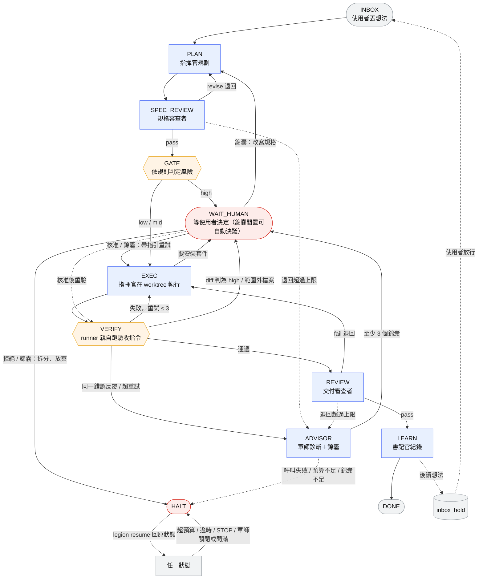

# 閉環流程

> 由 `src/legion/diagrams.py` 產生，與 GitHub README 的圖相同；請改程式，不要手改此檔。

![[AI/img/flow.svg]]

圖例：藍色＝Claude 擔任的角色、橘色＝runner 以程式判斷（不經 LLM）、紅色＝停下來等人或熔斷、灰色＝起點、終點與暫存；虛線（畫布上為灰線）是例外或補救路徑。橘色光暈與底部字幕依序重播任務 T-0022 的真實路徑，連線上的虛線往流向移動；系統開啟「減少動態」時不播放。

## 靜態版

互動版（可拖曳、標註各角色模型）：[[流程.canvas]]；任務總覽：[[儀表]]
